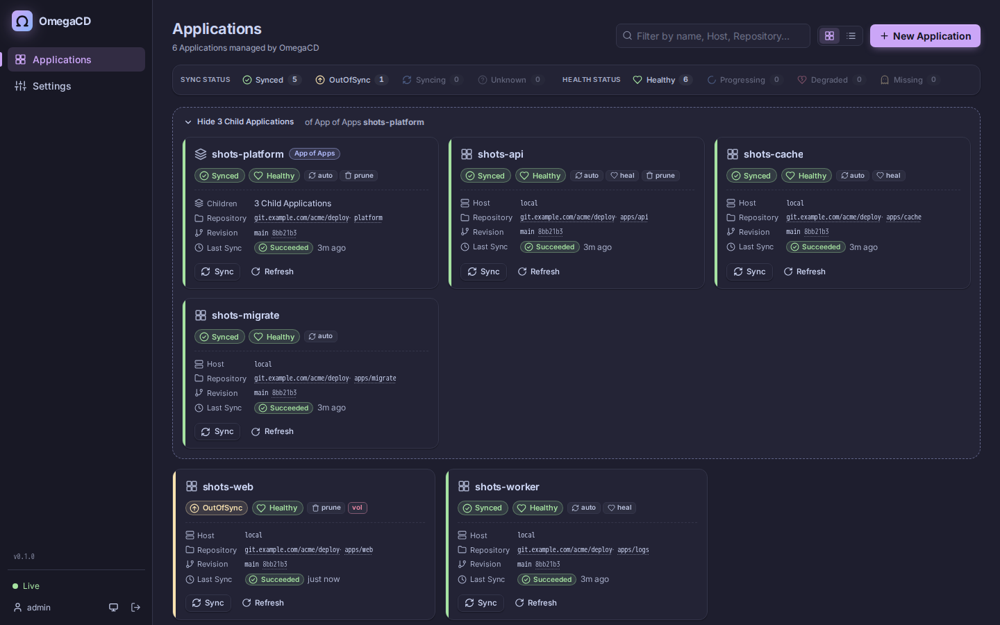
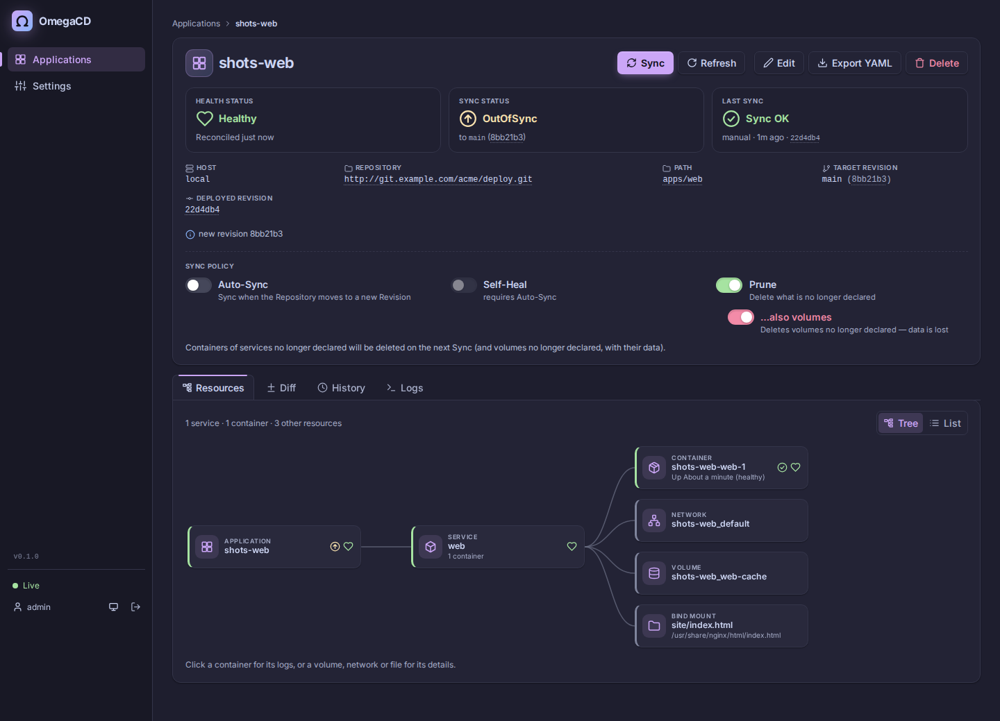
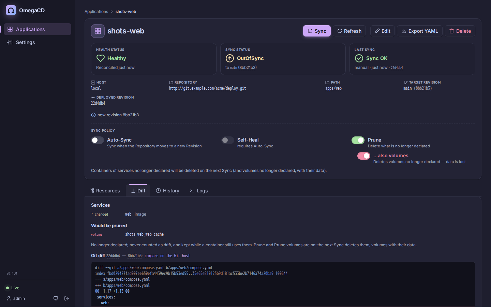
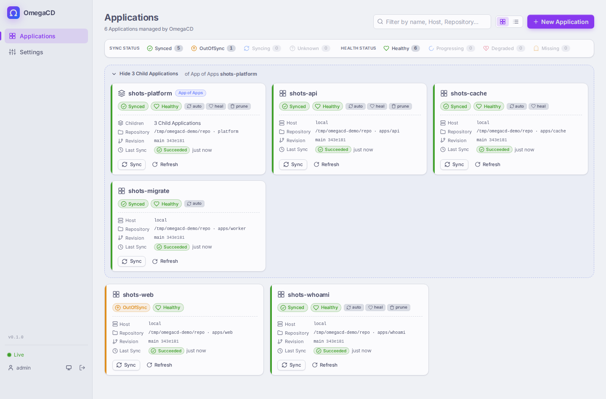
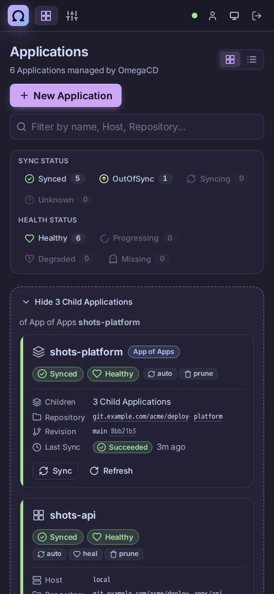
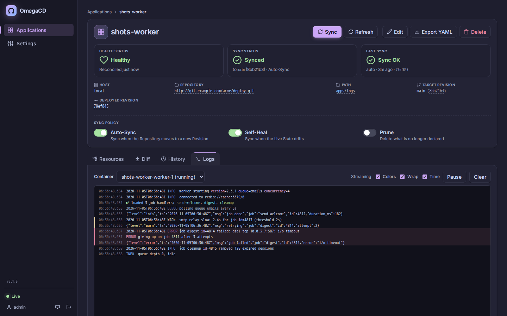
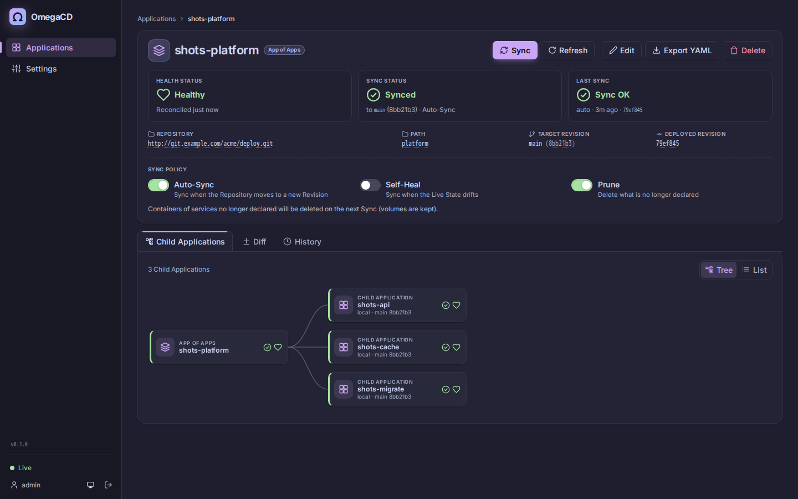
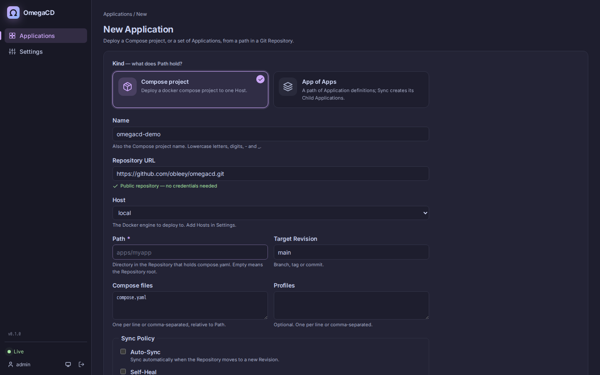
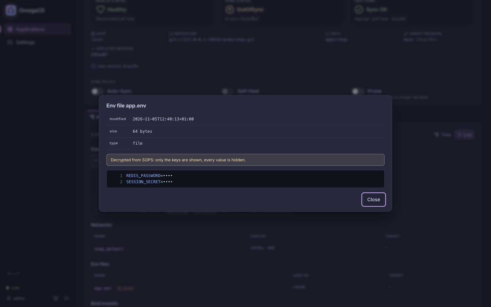
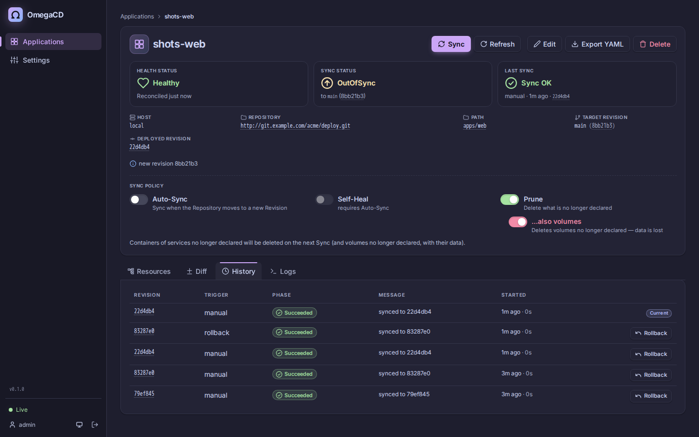

<p align="center">
  
</p>

<p align="center">
  <b>GitOps continuous delivery for Docker Compose hosts.</b>
</p>

<p align="center">
  <a href="https://github.com/obleey/omegacd/actions/workflows/ci.yml"></a>
  <a href="LICENSE"></a>
  <a href="https://github.com/obleey/omegacd/releases/latest"></a>
  <a href="https://github.com/obleey/omegacd/pkgs/container/omegacd"></a>
</p>

OmegaCD watches Git repositories and keeps Docker Compose projects on your Docker hosts in line with what is committed. Point an **Application** at a path in a repo; OmegaCD shows whether it is in sync and healthy, shows the diff, and syncs it — manually, or automatically on every push.



> **Status: early.** OmegaCD works and is tested against real Docker engines, but it is young and the API may still change. Feedback, bug reports and ideas are very welcome — please [open an issue](https://github.com/obleey/omegacd/issues).

## Why

Plenty of apps run on plain Docker hosts — a VPS, a homelab box, a few servers for a small team or an agency's clients — with no Kubernetes in sight. Deploying usually means SSH-ing in and running `git pull && docker compose up -d`, and nobody can say for sure what is running, what changed, or how to get back to yesterday's version. OmegaCD makes Git the answer:

- **Git is the single source of truth.** What is committed is what runs; a deploy is a commit.
- **See the diff before you deploy.** Per-service changes and the Git diff between the deployed and the target Revision.
- **Drift detection and Self-Heal.** A container changed or removed by hand shows up as OutOfSync, and OmegaCD can put it back.
- **History and Rollback.** Every Sync is recorded; roll back to any earlier Revision.
- **Secrets encrypted in Git.** SOPS + age files live next to your compose files and are decrypted only on the Host, by its Agent.
- **Many hosts from one place.** Every Host runs a small Agent that dials out to OmegaCD — no SSH into your servers, and its Applications keep running while OmegaCD is down. One UI, API and CLI for all of them.

It stays small: one binary — OmegaCD, and on each Host the same binary as its Agent — no database server, and your compose files unchanged. OmegaCD runs Compose as a library, so whatever `docker compose up` accepts works (except `build:` — build images in CI; OmegaCD pulls and runs them).

**Inspired by** the GitOps tools of the Kubernetes world — [Argo CD](https://argo-cd.readthedocs.io/) and [Flux](https://fluxcd.io/) — and the [OpenGitOps principles](https://opengitops.dev/) (declarative, versioned and immutable, pulled automatically, continuously reconciled), brought to Docker Compose. OmegaCD is an independent project, not affiliated with Argo CD, Flux or the CNCF.

## Features

- **Applications** — a Compose project (one or more compose files, optional profiles) at a path in a Git repo, tracking a branch, tag or commit, deployed to one Host
- **Sync Status and Health Status** — Synced / OutOfSync / Unknown; Healthy / Progressing / Degraded / Missing / Unknown — live over Server-Sent Events, resynced after reconnects
- **Sync Policy** — manual Sync, or Auto-Sync on new commits, Self-Heal on drift, and Prune
- **Diff** — Live (the compose files on the Host) and Desired (the compose files in Git) side by side and as a Compose diff, plus the per-service changes and the Git diff between the deployed and the target Revision
- **History and Rollback** — every Sync Operation is recorded; roll back to any earlier Revision
- **App of Apps** — declare Applications in Git; one parent Application creates, updates and deletes its children
- **Hosts** — each runs an Agent (Docker or Podman, rootful or rootless) that connects out to OmegaCD; enrolled with a single-use invite and an approved key fingerprint
- **Secrets** — SOPS + age encrypted files in Git, decrypted only on the Host, with a Host Key that never leaves it
- **Change detection** — Git polling plus GitHub, GitLab and Gitea/Forgejo webhooks, and a generic one for anything else
- **Web UI** — resource tree, diffs, colored live container logs, syntax colors for compose and config files (YAML, .env, nginx, Apache, Caddyfile, TOML, Markdown… ~240 formats via Shiki), repository access check while creating an Application, links to the Git host, light/dark/system theme, works on phones
- **CLI and API** — REST API with API tokens; a CLI for scripts and CI (`omegacd app sync myapp --wait`)
- **Prometheus metrics** at `/metrics`

| Application detail: resource tree and Sync Policy | Compose diff of a pending change |
| --- | --- |
|  |  |

| Light theme | On a phone |
| --- | --- |
|  |  |



## Install

OmegaCD (the Control Plane) needs an [age](https://github.com/FiloSottile/age) key, the Master Key: it seals the credentials OmegaCD stores, so **back it up** with the data directory. OmegaCD deploys nothing itself: every machine that runs Applications, the one OmegaCD runs on included, is a [Host](#hosts) with an Agent.

**Quick install** — on a Linux server with Docker, or into a Kubernetes cluster with `kubectl`:

```sh
curl -fsSL https://raw.githubusercontent.com/obleey/omegacd/main/deploy/install.sh | sh
```

[`install.sh`](deploy/install.sh) asks for the port (Compose) or the kubectl context and namespace (Kubernetes, always confirmed), creates the Master Key, starts OmegaCD and prints the URL and the initial admin password. It needs no `age` or `sops` on the server (`omegacd keygen` makes the key), never replaces an existing key, and runs unattended with `OMEGACD_TARGET`, `OMEGACD_VERSION` and the settings listed at its top. The options below do the same by hand.

### Option 1: Docker Compose (recommended)

Download [`deploy/compose.yaml`](deploy/compose.yaml). It mounts a data volume, the age key and `known_hosts` — no Docker socket: OmegaCD deploys through Agents. Every setting has a default you can override with environment variables or a `.env` file next to it: `OMEGACD_IMAGE` (pin a release), `OMEGACD_PORT`, `OMEGACD_DATA` (a folder instead of the volume), `OMEGACD_AGE_KEY`, `OMEGACD_KNOWN_HOSTS`.

```sh
curl -fsSLO https://raw.githubusercontent.com/obleey/omegacd/main/deploy/compose.yaml
```

```sh
age-keygen -o age.key && chmod 600 age.key   # the Master Key: seals the credentials OmegaCD stores
touch known_hosts                             # add Git servers with ssh-keyscan when you use Git over SSH
docker compose up -d
docker compose logs omegacd | grep "initial admin password"
```

Open http://localhost:8080, log in as `admin` with the password from the log, and set a new password (required on first login). Put OmegaCD behind a TLS-terminating reverse proxy before exposing it.

Then [add a Host](#hosts) — this machine too, if Applications should run on it.

**Upgrade:** bump the image tag (or `docker compose pull` for `latest`) and run `docker compose up -d`. Data lives in the `omegacd-data` volume.

**From v0.1:** there is no migration. v0.2 refuses a v0.1 database with a message and leaves it untouched: export each Application's definition with v0.1's `omegacd app export`, start v0.2 with a new data directory, enroll an Agent on each Host and create the Applications again (naming their `host:`); running stacks are taken over by name.

### Option 2: Binary + systemd

Download the `linux_amd64` or `linux_arm64` archive from [GitHub Releases](https://github.com/obleey/omegacd/releases) and verify it:

```sh
VERSION=v0.1.0 ARCH=amd64
curl -LO https://github.com/obleey/omegacd/releases/download/$VERSION/omegacd_${VERSION}_linux_${ARCH}.tar.gz
curl -LO https://github.com/obleey/omegacd/releases/download/$VERSION/SHA256SUMS
sha256sum --ignore-missing -c SHA256SUMS
tar -xzf omegacd_${VERSION}_linux_${ARCH}.tar.gz
sudo install -m 0755 omegacd_${VERSION}_linux_${ARCH}/omegacd /usr/local/bin/omegacd
```

Create a service user and its key files:

```sh
sudo useradd --system --home-dir /var/lib/omegacd --shell /usr/sbin/nologin omegacd
sudo install -d -m 0750 -o omegacd -g omegacd /etc/omegacd
sudo -u omegacd age-keygen -o /etc/omegacd/age.key
sudo -u omegacd install -m 0600 /dev/null /etc/omegacd/known_hosts
sudo chmod 600 /etc/omegacd/age.key
```

Install the unit from [`packaging/omegacd.service`](packaging/omegacd.service) and start it:

```sh
sudo curl -Lo /etc/systemd/system/omegacd.service https://raw.githubusercontent.com/obleey/omegacd/main/packaging/omegacd.service
sudo systemctl daemon-reload
sudo systemctl enable --now omegacd
journalctl -u omegacd | grep "initial admin password"
```

<details>
<summary><code>packaging/omegacd.service</code></summary>

```ini
[Unit]
Description=OmegaCD - GitOps continuous delivery for Docker Compose
Documentation=https://github.com/obleey/omegacd
After=network-online.target
Wants=network-online.target

[Service]
Type=simple
User=omegacd
Group=omegacd
ExecStart=/usr/local/bin/omegacd server
Restart=on-failure
RestartSec=5

Environment=OMEGACD_ADDR=:8080
Environment=OMEGACD_DATA=/var/lib/omegacd
Environment=OMEGACD_AGE_KEY_FILE=/etc/omegacd/age.key
Environment=OMEGACD_SSH_KNOWN_HOSTS=/etc/omegacd/known_hosts
EnvironmentFile=-/etc/omegacd/omegacd.env

StateDirectory=omegacd
StateDirectoryMode=0750

NoNewPrivileges=yes
ProtectSystem=full
ProtectHome=yes
PrivateTmp=yes
ProtectKernelTunables=yes
ProtectKernelModules=yes
ProtectControlGroups=yes
RestrictSUIDSGID=yes
LockPersonality=yes

[Install]
WantedBy=multi-user.target
```

</details>

Further settings (webhook secret, trusted proxies, …) go into `/etc/omegacd/omegacd.env` (mode 0600). **Upgrade:** replace `/usr/local/bin/omegacd` and `systemctl restart omegacd`.

### Option 3: CLI only

For laptops and CI, download the `darwin_*` or `linux_*` archive from [Releases](https://github.com/obleey/omegacd/releases) and put `omegacd` on your `PATH`. It is the same binary as the server — see [CLI](#cli).

### Option 4: Kubernetes

OmegaCD can run in a cluster as the Control Plane; the [Hosts](#hosts) it deploys to run Docker or Podman, each with an Agent that connects to it (through the Ingress). [`deploy/kubernetes.yaml`](deploy/kubernetes.yaml) has a PersistentVolumeClaim, a single-replica Deployment and a Service:

```sh
kubectl create namespace omegacd
kubectl -n omegacd create secret generic omegacd-keys --from-file=age.key --from-file=known_hosts
kubectl -n omegacd apply -f https://raw.githubusercontent.com/obleey/omegacd/main/deploy/kubernetes.yaml
kubectl -n omegacd logs deploy/omegacd | grep "initial admin password"
```

Keep `replicas: 1` (one controller per SQLite database). Add the commented Ingress for your host name, and set `OMEGACD_TRUSTED_PROXIES` to the ingress controller.

### Versions

The version is always the Git release tag: pushing tag `v0.1.0` builds and stamps the binaries (`omegacd version` → `omegacd v0.1.0`) and the image (`ghcr.io/obleey/omegacd:0.1.0`, `:0.1` and `:latest`). The server reports it at `GET /api/version`, and the UI shows it in the sidebar and on the login page.

## Your first Application

This repository has a ready example, [`examples/hello`](examples/hello): nginx serving a page that lives in Git. It runs on a [Host](#hosts): enroll an Agent on the machine you want it on first. The examples call that Host `local` — any name works; this machine is a Host like any other:

```sh
omegacd host add local      # prints the command that starts its Agent, with a single-use invite
# run that command on the machine, then approve the fingerprint it prints:
omegacd host approve local SHA256:…
```

```yaml
# examples/hello/compose.yaml
services:
  web:
    image: nginx:1.29-alpine
    ports:
      - "8081:80"
    volumes:
      - ./index.html:/usr/share/nginx/html/index.html:ro # a file from Git, restored on every Sync
    restart: unless-stopped
```

**In the UI:** **New Application** → name `hello`, repository `https://github.com/obleey/omegacd`, path `examples/hello`, Host `local`, turn on **Auto-Sync**, **Create**. OmegaCD deploys it within seconds; open http://localhost:8081 (or the server's address). The Application page shows its containers, the Diff, History and Logs.

**With the CLI** (`omegacd login` first, see [CLI](#cli)):

```sh
omegacd app create hello --repo https://github.com/obleey/omegacd --path examples/hello --host local --auto-sync
omegacd app wait hello --sync --health
```

**Make it yours:** copy `examples/hello` into your own repository, point the Application at it, change `index.html` and push — OmegaCD sees the new commit (on the next poll, or within seconds [with a webhook](#webhooks)) and recreates the container with the new page. Add a `.sops.env` next to it for [secrets](#secrets).

### Your first App of Apps

Instead of creating each Application by hand, declare them in Git. [`examples/apps.yaml`](examples/apps.yaml) defines two: `hello` (Auto-Sync on) and [`whoami`](examples/whoami) (Auto-Sync off — it waits for a Sync):

```yaml
# examples/apps.yaml
name: hello
repoURL: https://github.com/obleey/omegacd.git
path: examples/hello
host: local
autoSync: true
selfHeal: true
---
name: whoami
repoURL: https://github.com/obleey/omegacd.git
path: examples/whoami
host: local
autoSync: false
```

**New Application** → name `examples`, kind **App of Apps**, repository `https://github.com/obleey/omegacd`, path `examples`, **Create**, then **Sync** it (or `omegacd app create examples --repo https://github.com/obleey/omegacd --path examples --kind apps && omegacd app sync examples --wait`). The Sync creates both Child Applications and deploys them — http://localhost:8081 and http://localhost:8082. From then on a new commit deploys `hello` by itself, while `whoami` shows *OutOfSync* until you Sync it (or the App of Apps). In your own repository, one folder of definitions like this per server describes everything that runs there; see [Defining Applications](#defining-applications) for every field.

## Concepts

| Term | Meaning |
| --- | --- |
| **Application** | A Compose project whose desired state lives at a path in a Git repository and is deployed to one Host. |
| **App of Apps** | An Application whose path holds Application definitions instead of compose files. Syncing it creates and updates its Child Applications, and with Prune deletes those no longer declared. It deploys nothing itself and has no Host: each Child Application names its own, so one App of Apps can span several Hosts. |
| **Child Application** | An Application declared in an App of Apps. Its settings — and Rollback — are owned by Git, not the UI. A manual Sync of the parent also syncs children that are OutOfSync or whose last Sync failed; a Refresh of the parent refreshes all children. |
| **Host** | A machine Applications are deployed to, through its Agent: `omegacd agent`, enrolled with `omegacd host add`. The machine OmegaCD runs on is a Host like any other. |
| **Sync** | Making the running containers match the compose files at the target Revision (commit). Each attempt is a Sync Operation, recorded as Running, Succeeded or Failed. |
| **Sync Status** | **Synced**, **OutOfSync** (Live State differs, or a new Revision is waiting), or **Unknown** (the desired state cannot be determined, e.g. Git is unreachable). |
| **Health Status** | **Healthy**, **Progressing**, **Degraded**, **Missing**, or **Unknown** (its Host's Agent hasn't reported it), from container state and healthchecks, as the Agent reports them. A container that exited 0 counts as Healthy (one-shot jobs) — unless its service has a restart policy, then it is long-running and stopped means Degraded. |
| **Rollback** | A Sync to an earlier Revision from the history. It turns Auto-Sync off so the next commit does not undo it; a manual Sync to the target Revision ends it. |

**Sync Policy**, per Application:

- **Auto-Sync** — Sync whenever the repository moves to a new Revision.
- **Self-Heal** — also Sync when the Live State drifts without a new commit (a container was stopped, removed or changed by hand). Requires Auto-Sync.
- **Prune** — what happens to services no longer declared (removed from the compose files, or their profile switched off): with Prune **off**, a Sync *stops* their containers; with Prune **on**, it *deletes* their containers and the project networks no longer declared (a network still used by any container is kept and shown as prune pending). Volumes are kept. Prune is also available as a one-off Sync option.
- **Prune volumes** — a sub-option of Prune (off by default, and turned off with Prune): a Sync also *deletes* the project's named volumes no longer declared, **with their data**, unless a container (of any project, even a stopped one) still uses them. External volumes, volumes OmegaCD's Compose project did not create, volumes of profile-disabled services and host paths are never touched. The Diff tab lists undeclared networks and volumes under *Would be pruned*; they never make an Application OutOfSync.

**Change detection.** Compose recreates a container when its service definition changes. OmegaCD additionally hashes the *content* of file-based `configs:` and `secrets:` and of bind-mounted regular files inside the Application's path into a `dev.omegacd.content-hash` label — so editing `nginx.conf` in Git recreates the container that mounts it, and shows up as OutOfSync until synced. Images are pulled by each service's `pull_policy` (Compose default: only when missing) — push a new tag rather than overwriting one.

## Defining Applications

Create Applications in the UI (**New Application**), with the CLI, or declaratively in Git with an **App of Apps**. Point an Application with kind *App of Apps* at a directory of definitions; every `*.yaml` / `*.yml` file directly in it may hold several documents:

```yaml
# platform/apps.yaml — the path of the App of Apps "platform"
name: web
repoURL: https://github.com/acme/deploy.git
path: apps/web                 # directory with the compose files
targetRevision: main           # branch, tag or commit
composeFiles: [compose.yaml]   # default: the first of compose.yaml, compose.yml, docker-compose.yaml, docker-compose.yml
profiles: [prod]               # optional Compose profiles
host: edge-01                  # required: the Host whose Agent deploys it
autoSync: true
selfHeal: true
prune: true
pruneVolumes: false            # with prune: also delete volumes no longer declared (data is lost)
workDir: /srv/apps             # optional: the Host's folder for its files, under a root the Agent
                               # allows (OMEGACD_AGENT_WORKDIR_ALLOW); default the Agent's work dir. Not inherited
---
name: cache
repoURL: https://github.com/acme/deploy.git
path: apps/cache
host: edge-01
autoSync: true
selfHeal: false
prune: false
```

`omegacd app export NAME` (or **Export YAML** in the UI) writes this format for an existing Application, and `omegacd app create -f FILE` reads it. Every Application names its `host:`: there is no default, and a definition without one fails the App of Apps' Sync, so nothing is deployed to a Host Git didn't name. Nested App of Apps are not supported. `adopt: true` lets an Application take over an existing, unmanaged Compose project of the same name.



**What each action does on an App of Apps:**

| Action | Order | Children |
| --- | --- | --- |
| **Refresh** | children first, then the App of Apps (its status sums up theirs) | all re-read Git — one Refresh after fixing a Git credential brings them all back |
| **Sync** (manual) | the App of Apps first (creates, updates, with Prune deletes the definitions), then children | only those OutOfSync or whose last Sync failed; Synced ones are not touched |
| **Auto-Sync** | the App of Apps only | each child follows its own Sync Policy |

The App of Apps shows the worst Health of its children.

**Recommended Sync Policies:**

- **The App of Apps:** Auto-Sync on, Prune **off**. A definition removed from Git then only marks its Application *not in Git* and keeps it running until you delete it — a bad commit can't take services down.
- **Stateless Applications** (proxies, dashboards, monitoring): Auto-Sync and Self-Heal on; a push deploys them.
- **Applications with a database** (WordPress, Forgejo, analytics): Auto-Sync off, or on without Prune — upgrades there often want a backup or a migration first.
- **Prune volumes** only where losing the data is fine; never on a database Application.

**Database migrations.** Use Compose's own init pattern: a one-shot service that runs the migration, and the app waiting for it to complete. OmegaCD runs the migration first and touches the rest only once it succeeded: a failing migration fails the Sync with its output and leaves the running app as it was.

```yaml
services:
  migrate:
    image: ghcr.io/acme/shop:1.4           # the app's own image
    command: ["php", "artisan", "migrate", "--force"]   # Django: python manage.py migrate; Rails: bin/rails db:migrate
    depends_on: {db: {condition: service_healthy}}
  app:
    image: ghcr.io/acme/shop:1.4
    depends_on: {migrate: {condition: service_completed_successfully}}
```

The migration runs on **every** Sync, and again when the Host restores the Application after a reboot, so it must be idempotent: running it twice changes nothing the second time. Laravel's, Django's and Rails' migrations are (they record what ran). A completed migration counts as Healthy and Self-Heal leaves it alone. Something that should run once per change rather than on every Sync, like a backup before an upgrade, is a Sync hook ([Roadmap](ROADMAP.md)).

**Labels.** Every container OmegaCD creates carries `managed-by=omegacd` and `dev.omegacd.application=<name>` (on Docker and Podman alike), so `docker ps --filter label=managed-by=omegacd` lists everything OmegaCD manages. Containers created before an upgrade get the label on their next recreate.

## Where your data lives

Each Application has its own folder in its Host's work dir (the Agent's `OMEGACD_AGENT_WORKDIR`, or the Application's `workDir:`): `<work dir>/<name>`, or `<work dir>/<App of Apps>/<name>` for a Child Application (an App of Apps itself has no files). Its Agent makes that folder match Git on every Sync (files not in Git are deleted), so **data must not live there**. Only named volumes and absolute paths keep data:

| In your compose file | Where the data is | Kept across reboots, Syncs and deletes? |
|---|---|---|
| `- media:/data` (named volume) | Docker's volume storage | ✅ kept, even with Prune — deleted only by **Prune volumes** once no longer declared, or by deleting the Application with **Also delete its volumes** (`app delete --volumes`) |
| `- /opt/media/torrents:/data` (absolute path) | that folder **on the Host running the container** | ✅ OmegaCD never touches it; a missing folder is created by Docker (as root, so `chown` it for non-root images) |
| `- ./nginx.conf:/etc/nginx/nginx.conf:ro` | a file from Git | ✅ restored from Git; changing it recreates the container |
| `- ./conf.d:/etc/nginx/conf.d:ro` | a folder from Git | ✅ for config only: anything a container writes into it is deleted on the next Sync (a `.gitkeep` doesn't make it a data folder) |
| `- ./data:/data` (not in Git) | — | ⛔ **refused**: every Sync deletes files that are not in Git, so the Sync fails and asks for a named volume or an absolute path. The same goes for `../` paths |

Changes *inside* data folders and volumes never count as drift. Back up volumes and data folders yourself (e.g. restic or borg) — OmegaCD doesn't.

**Folders OmegaCD didn't create are never synced into.** A work dir like `/opt/services` may already hold other folders. A Sync writes into an Application's folder only if it is missing or empty (or holds only empty directories), if the Agent recorded that it wrote there for that Application, or if a container OmegaCD created for it (`managed-by=omegacd`) runs from it — containers of other tools don't count. An App of Apps' folder may also hold its children's folders. Anything else fails, naming the folder: rename the Application, pick another work dir, or move the folder away. Older versions marked their folders with a `.omegacd` file instead: a folder marked for the Application is still taken, and the Sync deletes the marker; one marked for another Application is refused.

## Git access

Public repositories need no setup; the New Application form checks access as you type (public / private with a credential / denied, with an inline *Add credential*). For private ones, add a credential under **Settings → Repository credentials** (for reading Git repositories), matched by URL prefix: a username and password/token for HTTPS, or an SSH private key. Credentials are kept by the [Source Server](#standalone-source-server), not in OmegaCD's database: in `credentials.age` in its data dir, encrypted with its own key `source.key` (created at its first start, owner-only). Back up both together; without `source.key` the credentials can't be read. Secrets go in and are never shown again. Private images need **Settings → Registry credentials** (for pulling Docker images), keyed by registry host such as `ghcr.io` — not a URL.



SSH host keys are always verified against the `known_hosts` file (`OMEGACD_SSH_KNOWN_HOSTS`, default `/etc/omegacd/known_hosts`):

```sh
ssh-keyscan github.com gitlab.com >> known_hosts   # verify the fingerprints against your provider's docs
```

## Hosts

Every Host runs an Agent: the same binary, as `omegacd agent`. It dials out to OmegaCD over one WebSocket — https only, except to its own machine — so nothing connects into your servers; it deploys with the Host's Docker or Podman, decrypts its secrets, reports Health, containers and logs, and keeps its Applications running and self-healing while OmegaCD is down.

```sh
omegacd host add web-1                       # prints the command that starts its Agent, with a single-use invite (an hour)
# on the server, as a user of its container engine (docker group, or rootless Docker or Podman):
OMEGACD_AGENT_CONTROL_PLANE=https://omegacd.example.com OMEGACD_AGENT_INVITE=omegacd-invite-… omegacd agent
omegacd host approve web-1 SHA256:…          # after comparing the fingerprint the Agent printed with host list's
```

Applications with `host: web-1` then deploy through it; a Sync to it while it's offline waits for it, and its Applications show their last known state. `omegacd agent --help` lists its settings (its work dir, state dir, engine). The machine OmegaCD runs on is a Host like any other: give it an Agent too, and OmegaCD can deploy its own Compose project as an Application — an Agent only refuses the project it runs in itself.

## Secrets

Commit secrets encrypted with [SOPS](https://github.com/getsops/sops) to the **Host Key** of the Host the Application deploys to. Each Host's Agent makes its own age key when it enrolls and keeps it in its state dir; only its public half reaches OmegaCD, so OmegaCD can decrypt nothing, and a key leaked from one server exposes only that server's secrets.

**Settings → Hosts** shows each Host's public key, and the **Keys** dialog has the ready `.sops.yaml` rule for it (**Copy .sops.yaml for all Hosts** gives one rule per Host); `omegacd host key show HOST` prints it. Back up each Agent's state dir: it holds the Host Key.

```yaml
# .sops.yaml — the paths are up to you
creation_rules:
  - path_regex: apps/prod/.*\.sops\.
    age: age1...   # Host Key of "prod"
  - path_regex: apps/local/.*\.sops\.
    age: age1...   # Host Key of "local"
```

Decryption uses age keys only: files encrypted solely with PGP or a cloud KMS are not decrypted.

A file its Host's key can't decrypt fails the Sync, naming the keys it is encrypted for. Rotating a Host Key comes later ([Roadmap](ROADMAP.md)).

Any file whose name contains `.sops.` is decrypted by the Agent at Sync time, with `.sops.` removed from the name — `app.sops.env` becomes `app.env`, `db-password.sops.txt` becomes `db-password.txt`. The work dir keeps only the decrypted file, which is what the containers read; the encrypted one stays in Git:

```sh
sops encrypt --age age1... --input-type dotenv --output-type dotenv app.env > app.sops.env
sops encrypt --age age1... --input-type binary --output-type binary db-password.txt > db-password.sops.txt
rm app.env db-password.txt   # commit only the .sops. files
```

```yaml
services:
  app:
    image: ghcr.io/acme/app:1.4.2
    env_file: app.env          # decrypted from app.sops.env
    secrets: [db_password]
secrets:
  db_password:
    file: ./db-password.txt    # decrypted from db-password.sops.txt
```

The format is taken from the decrypted file's extension: `.yaml`/`.yml`, `.json`, `.env`/`.dotenv`, `.ini`, anything else binary. Plaintext exists only in the Application's folder on its Host (mode 0600; the Agent's default work dir is under `/run`, a tmpfs on most Linux hosts) — never in Git, never on OmegaCD's side and never in the UI, which shows only the keys of decrypted env files:



### What reaches the disk

How a secret reaches the container decides where it ends up:

| In your compose file | Where the plaintext is |
| --- | --- |
| `env_file: app.env` or `${VAR}` from a decrypted `.env` | the work dir, **and Docker's container configuration on disk** (`/var/lib/docker`, readable with `docker inspect`) — that is how Docker passes environment variables, with or without OmegaCD |
| `secrets: [db_password]` with `file: ./db-password.txt` | **only the work dir**: with the default `/run` it never touches disk; the app reads `/run/secrets/db_password` |

For a secret that must stay off disk, use a Compose secret file and, where the image supports it, a `*_FILE` variable (`MARIADB_PASSWORD_FILE: /run/secrets/db_password`).

## Webhooks

Polling (`OMEGACD_POLL_INTERVAL`, default 3m) always works; webhooks make Syncs start within seconds of a push. Add a push webhook pointing to:

| Provider | URL | Secret |
| --- | --- | --- |
| GitHub | `https://omegacd.example.com/api/webhooks/github` | "Secret" field, checked via `X-Hub-Signature-256` |
| GitLab | `https://omegacd.example.com/api/webhooks/gitlab` | "Secret token", checked via `X-Gitlab-Token` |
| Gitea / Forgejo | `https://omegacd.example.com/api/webhooks/gitea` | "Secret", checked via the HMAC signature header |
| Anything else | `https://omegacd.example.com/api/webhooks/generic` | `Authorization: Bearer <secret>`; the body is `{"repoURL": "<the repository's URL>"}` |

**Other Git hosts** (Bitbucket, Azure DevOps, …) send payloads of their own, which OmegaCD doesn't parse: let polling find their pushes, or call the generic endpoint from a CI step after a push:

```sh
curl -fsS -H "Authorization: Bearer $OMEGACD_WEBHOOK_SECRET" -d '{"repoURL":"https://bitbucket.org/acme/deploy.git"}' \
  https://omegacd.example.com/api/webhooks/generic
```

Set the same value in `OMEGACD_WEBHOOK_SECRET`. A webhook only triggers a refresh of the Applications using that repository; without a secret anyone who can reach the URL can trigger refreshes, so set one.

**Polling with webhooks.** Webhooks are always on; polling is the safety net for a push OmegaCD missed (it was down, or the Git host could not reach it). With webhooks set up, a long interval like `OMEGACD_POLL_INTERVAL=1h` is a good fit; `0` turns polling off entirely — changes then arrive only through webhooks, **Refresh**, or a restart of OmegaCD, which checks everything once.

## CLI

The same binary is also the client: `omegacd` (or `omegacd server`) runs the server, any other command talks to one. On a laptop or in CI, get it from [Releases](https://github.com/obleey/omegacd/releases) (see [Option 3](#option-3-cli-only)). Create an API token under **Settings → API tokens**, then log in once:

```sh
omegacd login --server https://omegacd.example.com --token ocd_...   # saved to ~/.config/omegacd/config.json (0600)
```

### Everyday use

```sh
omegacd app list                          # all Applications, Child Applications indented under their App of Apps
omegacd app get web                       # status, Revisions, Sync Policy; -o json for the API object
omegacd app diff web                      # what the next Sync changes (exit 1 if anything)
omegacd app sync web --wait               # Sync, then wait until it succeeded and the app is Healthy
omegacd app logs web nginx -f --tail 50   # follow one service's logs
omegacd app history web                   # past Sync Operations with their IDs
omegacd app rollback web 42 --wait        # back to the Revision of operation 42 (turns Auto-Sync off)
omegacd app refresh platform              # re-read Git now; on an App of Apps, its children too
omegacd app export web > web.yaml         # the definition, for an App of Apps folder

# create an Application from the command line (or app create -f web.yaml)
omegacd app create web --repo https://github.com/acme/deploy --path apps/web --host vps --auto-sync --self-heal

# delete it: containers too (asks first); --volumes also deletes its named volumes and their data
omegacd app delete web
```

### In CI

Pass the server and token as environment variables, and let `--wait` fail the job when a deployment fails:

```yaml
# GitHub Actions, after pushing a new image tag to the deploy repo
- run: omegacd app sync myapp --wait --timeout 5m
  env:
    OMEGACD_SERVER: https://omegacd.example.com
    OMEGACD_TOKEN: ${{ secrets.OMEGACD_TOKEN }}
```

`--wait` exits 0 when the Sync Operation succeeded and the Application is Healthy, and 1 when the operation failed, the Application is Degraded, or `--timeout` (default 10m) passes. `--no-health` stops after the operation. `app diff` exits 0 without differences, 1 with, 2 on an error — handy as a check.

### Moving an existing server to OmegaCD

Stacks you started by hand with `docker compose up` can move into Git without downtime planning. `omegacd import` runs **on the server, in a checkout of your repository**, and reads the stacks running there — nothing on the server changes (reading another Host's stacks through its Agent comes later, [Roadmap](ROADMAP.md)):

```sh
cd ~/server-apps                           # your (possibly brand-new) Git repo
omegacd import --host vps --dry-run        # see what would happen; vps: this server's name in OmegaCD
omegacd import --host vps                  # write it
```

```text
✓ blog → apps/blog (2 services)
    config   nginx.conf
    data     wp-content → /opt/stacks/blog/wp-content (stays on the host)
    secret   db.env → db.sops.env, encrypted for age1qv7…8x2c
    moved    wordpress: WORDPRESS_DB_PASSWORD from the compose file into the encrypted .sops.env
    takeover recreates its containers once (they mount files that now come from Git)
✓ uptime → apps/uptime (1 service)
    takeover keeps its containers running
```

For each stack it:

- copies the compose files and the **config** they mount (files up to 1 MB, read-only folders up to 1 MB) into `apps/<name>/`;
- leaves **data** where it is: writable or big folders become absolute paths on the server (`./wp-content` → `/opt/stacks/blog/wp-content`), named volumes stay as they are;
- **encrypts secrets** with the server's Host Key: env files with password-like keys become `*.sops.env`, Compose secret files and bind-mounted files that hold a key or credential (by name, or by content: private keys, age keys, `password:`/`token=` settings) `*.sops.*` — never as is; one without a file extension is left out with a warning — and passwords written in `environment:` move into an encrypted `.sops.env` (the compose file then says `${WORDPRESS_DB_PASSWORD}`). The key is looked up on your OmegaCD by `--host` (the Host's Agent must have enrolled), or given with `--recipient age1…`;
- adds a definition to `platform/apps.yaml` with `host: vps` and `adopt: true`, Auto-Sync **off**;
- says what the takeover will do: containers that only use images and volumes keep running; those mounting files from the stack's folder are recreated once.

Then review with `git diff`, commit and push, and create an App of Apps with path `platform`. Check each Application's Diff and Sync it to take its stack over. Name stacks (`omegacd import blog uptime`) to import only those. Stacks already managed by OmegaCD or already defined are skipped, and an existing `apps/<name>` is only overwritten with `--force`.

### Hosts and keys

```sh
omegacd host list                          # Hosts with their Agents, connection and Host Key
omegacd host add web                       # a Host; prints the command that starts its Agent, with its invite
omegacd host approve web SHA256:…          # after comparing the fingerprint the Agent printed with host list's
                                           # then Applications with host: web deploy through its Agent
omegacd host rotate web                    # the Agent makes a new signing key
omegacd host allow web 203.0.113.7         # its Agent may connect only from there (CIDRs too; none: anywhere)
omegacd host unlock web                    # locked by two connections with one key, for a harmless cause
omegacd host delete web                    # revokes its Agent's key (a key that may be stolen: delete, add again)
omegacd host key show web                  # its Host Key's public half, for .sops.yaml
omegacd keygen --out age.key               # a new age key, e.g. the Master Key for a fresh install
```

### All commands

| Command | |
| --- | --- |
| `login --server URL --token TOKEN`, `logout`, `version` | |
| `app list`, `app get NAME` | `-o json` for the raw API object |
| `app create NAME --repo URL --host H [--path P] [--revision R] [--file F]... [--profile P]... [--kind apps] [--auto-sync] [--self-heal] [--prune [--prune-volumes]] [--adopt]` | or `app create -f app.yaml`; an App of Apps (`--kind apps`) has no Host |
| `app sync NAME [--prune] [--wait] [--no-health] [--timeout 10m]` | |
| `app refresh NAME` | re-read Git and the Live State now; an App of Apps refreshes its children too |
| `app diff NAME` | exit 0: no differences, 1: differences, 2: error |
| `app history NAME`, `app rollback NAME OP_ID [--wait]` | |
| `app wait NAME [--sync] [--health] [--timeout 10m]` | |
| `app logs NAME [CONTAINER_OR_SERVICE] [-f] [--tail N]` | |
| `app export NAME` | Application definition YAML |
| `app delete NAME [--cascade=false \| --volumes \| --forget] [--yes]` | asks first on a terminal; `--cascade=false` keeps the containers; `--volumes` also deletes the volumes and their data; its Host's Agent deletes, and to an offline Host the delete waits for it; `--forget` removes it from OmegaCD only, for an Application whose Host is gone for good |
| `import --host NAME [STACK]... [--recipient age1…] [--apps-dir apps] [--definitions platform/apps.yaml] [--repo-url URL] [--dry-run] [--force]` | run in your repository's checkout — see [Moving an existing server](#moving-an-existing-server-to-omegacd) |
| `host list` | |
| `host add NAME`, `host approve NAME FINGERPRINT` | enrolls a Host's Agent with a single-use invite (valid an hour), approved by its key's fingerprint; Applications on it then deploy through the Agent, which decrypts their secrets and reports their Health, containers, resources and logs (a Sync to it while it's offline waits for it; offline, the app shows its last known state and since when the Host is gone). The Agent connects over https only, except to its own machine; `OMEGACD_AGENT_CA_FILE` trusts a private CA |
| `host allow NAME [CIDR]...` | the addresses the Host's Agent may connect from (behind a reverse proxy: set `OMEGACD_TRUSTED_PROXIES`); none: anywhere |
| `host rotate NAME`, `host unlock NAME`, `host delete NAME` | a new signing key for the connected Agent; let a Host locked by two connections with its key connect again; delete a Host, revoking its Agent's key |
| `host key show HOST` | the public half of its Host Key; the private half never leaves the Host |
| `keygen [--out FILE]` | a new age key, like `age-keygen`; works offline, never overwrites a file |

Every command talking to a server takes `--server`, `--token` and `-o table|json`; `OMEGACD_SERVER` and `OMEGACD_TOKEN` override the saved login. Colors are used only on a terminal and honour `NO_COLOR`.



## Configuration

All server settings are environment variables:

| Variable | Default | |
| --- | --- | --- |
| `OMEGACD_ADDR` | `:8080` | Listen address |
| `OMEGACD_DATA` | `/data` | Database (`omegacd.db`), Git cache and rendered files |
| `OMEGACD_AGE_KEY_FILE` | `/etc/omegacd/age.key` | age identity, the Master Key: seals the credentials OmegaCD stores. Required |
| `OMEGACD_SSH_KNOWN_HOSTS` | `/etc/omegacd/known_hosts` | Host keys of Git servers, for Git over SSH |
| `OMEGACD_POLL_INTERVAL` | `3m` | How often Git is polled (Go duration); `0` turns polling off (webhooks only, see [Webhooks](#webhooks)) |
| `OMEGACD_ADMIN_PASSWORD` | *(generated)* | Initial `admin` password, used only on first start. If unset, a random one is logged and must be changed on first login |
| `OMEGACD_WEBHOOK_SECRET` | *(none)* | Shared secret for webhooks |
| `OMEGACD_TRUSTED_PROXIES` | *(none)* | Comma-separated IPs/CIDRs of reverse proxies whose `X-Forwarded-For` is trusted |
| `OMEGACD_SOURCE_SERVER` | *(in-process)* | `https://host:port` of a standalone Source Server (see below) |
| `OMEGACD_SOURCE_TLS_DIR` | `/etc/omegacd/source-tls` | Certificates from `omegacd source-certs`: the Control Plane reads `ca.pem`, `client.pem`, `client.key`; the Source Server `ca.pem`, `server.pem`, `server.key` |
| `OMEGACD_SOURCE_ADDR` | `:9090` | `omegacd source-server` only: its listen address |
| `OMEGACD_LOG_LEVEL` | `info` | `debug`, `info`, `warn` or `error`. `debug` logs why OmegaCD did what it did: each reconcile's verdict and Auto-Sync decision, the Compose options of a Sync, kept and pruned containers, renders and fetches. Secrets are never logged at any level. Every entry has a `component`, and the ones about an Application its `app`, and during a Sync its `op` (the Sync Operation), `revision` and `host`. The CLI reads it too (default `warn`; `debug` shows its API calls) |
| `OMEGACD_LOG_FORMAT` | `text` | `text`, or `json`: one JSON object per line |

### Standalone Source Server

The Source Server is the only part that reads Git. It runs inside the server by default; for production, run it
on its own (`omegacd source-server`) so that a breach of one doesn't hand over the other. They talk gRPC with
mutual TLS: the Source Server accepts nothing without the Control Plane's client certificate.

```sh
omegacd source-certs --out source-tls --host source-server   # --host: every name the Control Plane uses for it
# the Source Server (OMEGACD_DATA holds its Git cache): ca.pem, server.pem, server.key
OMEGACD_SOURCE_TLS_DIR=./source-tls omegacd source-server
# the Control Plane: ca.pem, client.pem, client.key
OMEGACD_SOURCE_SERVER=https://source-server:9090 OMEGACD_SOURCE_TLS_DIR=./source-tls omegacd server
```

`source-certs` keeps no CA key: nobody can issue another certificate the pair trusts; to replace them, delete the
directory and run it again on both sides. Keep the Source Server on an internal network. A reverse proxy or load
balancer between the two must pass TLS through untouched (TCP mode: Traefik `HostSNI` TCP router with
`tls.passthrough`, nginx `stream` with `ssl_preread`, HAProxy `mode tcp`): terminating TLS there would drop the
client certificate and the Source Server refuses the connection. Repository credentials live in the Source
Server's data dir (see [Git access](#git-access)).

CLI: `OMEGACD_SERVER`, `OMEGACD_TOKEN`, `NO_COLOR`.

## Metrics

`GET /metrics` (no authentication) serves Prometheus metrics:

- `omegacd_sync_operations_total{app, phase}` — finished Sync Operations
- `omegacd_sync_duration_seconds{app}` — Sync Operation duration histogram
- `omegacd_app_info{app, sync_status, health}` — always 1; one series per Application with its current status
- Go runtime and process metrics

`GET /healthz` returns `ok` for liveness checks.

## Security

- **Secrets stay secret.** Passwords, tokens and private keys are write-only in the API and UI; decrypted SOPS files are never shown (env files show keys only).
- **Credentials are sealed at rest**: registry credentials with the Master Key, repository credentials by the Source Server with its own key. Secrets in Git are decrypted only on their Host, by its Agent.
- **API tokens** (`ocd_…`) are shown once and stored only as SHA-256 hashes; the admin password is stored as a bcrypt hash.
- **Sessions** are HttpOnly, SameSite=Lax cookies (Secure behind HTTPS) that expire after 24 h of inactivity. State-changing requests from the browser must carry an `X-Requested-With` header, which cross-site forms cannot send (CSRF protection).
- **Login throttling** with exponential backoff per client IP. Behind a reverse proxy, set `OMEGACD_TRUSTED_PROXIES` so the real client IP is used.
- **Host keys** are always verified for Git over SSH; there is no "accept unknown host" mode.
- An Agent has full control of its Host's container engine, and OmegaCD can deploy anything to every Host — treat access to it like root access to those hosts.

Please report vulnerabilities privately, see [SECURITY.md](SECURITY.md).

## Development

Requires Go (version in `go.mod`), Node.js 24 and a running Docker engine.

```sh
make build              # web UI, then bin/omegacd (VERSION from git describe)
make test               # unit tests
make test-integration   # integration tests against the local Docker engine
make e2e                # end-to-end: throwaway OmegaCDs driven through the CLI (test/e2e; needs age-keygen and sops)
make stop               # stop a locally running omegacd (only the process listening on :8080)
make run                # build and run with data in ./data
make docker             # build the container image
make up / make down     # run that image with deploy/compose.yaml, same data as make run
```

| Path | |
| --- | --- |
| `cmd/omegacd` | entry point: server and CLI |
| `internal/api` | HTTP API, auth, webhooks, metrics |
| `internal/controller` | reconcile loop, Sync Operations, Sync Policy, App of Apps |
| `internal/agent`, `internal/agents` | the Agent on a Host; the Control Plane's side of its connection |
| `internal/engine` | Docker Compose (as a library) for the Agent: deploy, diff, health |
| `internal/source` | Source Server: Git fetch, rendering and validating Desired States, diffs, webhook parsing |
| `internal/blob`, `internal/workdir` | content-addressed file store; writing an Application's files |
| `internal/secrets`, `internal/crypto` | SOPS decryption, sealing with age |
| `internal/store` | SQLite storage |
| `internal/cli` | the CLI client |
| `web` | SvelteKit UI, embedded into the binary |

Contributions are welcome — see [CONTRIBUTING.md](CONTRIBUTING.md). What is tested, automatically and by hand, is in [TESTING.md](TESTING.md).

## Roadmap

See [ROADMAP.md](ROADMAP.md). **v0.2 is in development on `main`**: a redesign to pull-based Agents (every Host runs an Agent that dials out, secrets are decrypted only on the Host, Git lives in a separate Source Server). Its plan is in [docs/v0.2](docs/v0.2/README.md). This README describes `main`; v0.1 (push over SSH/TLS) is frozen on the `release-0.1` branch.

## License

[Apache-2.0](LICENSE)
