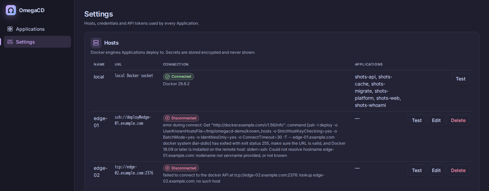

<p align="center">
  
</p>

<p align="center">
  <b>GitOps continuous delivery for Docker Compose — ArgoCD, but for plain Docker hosts.</b>
</p>

<p align="center">
  <a href="https://github.com/obleey/omegacd/actions/workflows/ci.yml"></a>
  <a href="LICENSE"></a>
  <a href="https://github.com/obleey/omegacd/releases/latest"></a>
  <a href="https://github.com/obleey/omegacd/pkgs/container/omegacd"></a>
</p>

OmegaCD watches Git repositories and keeps Docker Compose projects on your Docker hosts in line with what is committed. Point an **Application** at a path in a repo; OmegaCD shows whether it is in sync and healthy, shows the diff, and syncs it — manually, or automatically on every push.


> **Status: early.** OmegaCD works and is tested against real Docker engines, but it is young and the API may still change. Feedback, bug reports and ideas are very welcome — please [open an issue](https://github.com/obleey/omegacd/issues).

## Why

You have a few servers running `docker compose`, and deploying means SSH-ing in and running `git pull && docker compose up -d`. Kubernetes and ArgoCD would fix the workflow but are far more platform than you need. OmegaCD brings the ArgoCD model — Git as the source of truth, a live diff, sync status, health, history and rollback — to plain Docker engines:

- **One binary, one container.** No Kubernetes, no database server, no agents on your hosts.
- **Your compose files, unchanged.** OmegaCD runs Compose as a library; whatever `docker compose up` accepts, works (except `build:` — images are built in CI, OmegaCD pulls and runs them).
- **Many hosts.** Deploy to the local engine, or to remote engines over SSH or TLS.

## Features

- **Applications** — a Compose project (one or more compose files, optional profiles) at a path in a Git repo, tracking a branch, tag or commit, deployed to one Host
- **Sync Status and Health Status** — Synced / OutOfSync / Unknown; Healthy / Progressing / Degraded / Missing — live over Server-Sent Events
- **Sync Policy** — manual Sync, or Auto-Sync on new commits, Self-Heal on drift, and Prune
- **Diff** — the per-service changes and the Git diff between the deployed and the target Revision
- **History and Rollback** — every Sync Operation is recorded; roll back to any earlier Revision
- **App of Apps** — declare Applications in Git; one parent Application creates, updates and deletes its children
- **Remote Hosts** — Docker engines over `ssh://` (host keys verified) or `tcp://` with TLS
- **Secrets** — SOPS + age encrypted files in Git, decrypted only at Sync time
- **Change detection** — Git polling plus GitHub, GitLab and Gitea/Forgejo webhooks
- **Web UI** — resource tree, diffs, live container logs, light and dark theme, works on phones
- **CLI and API** — REST API with API tokens; a CLI for scripts and CI (`omegacd app sync myapp --wait`)
- **Prometheus metrics** at `/metrics`

| Application detail: resource tree and Sync Policy | Diff of a pending change |
| --- | --- |
|  |  |

| Light theme | On a phone |
| --- | --- |
|  |  |

## Install

OmegaCD needs a Docker engine and an [age](https://github.com/FiloSottile/age) key. The key seals stored credentials and decrypts your SOPS secrets, so **back it up** — without it, stored credentials and encrypted secrets cannot be read.

### Option 1: Docker Compose (recommended)

```yaml
# compose.yaml
services:
  omegacd:
    image: ghcr.io/obleey/omegacd:latest   # or pin a release, e.g. ghcr.io/obleey/omegacd:0.1.0
    ports:
      - "8080:8080"
    volumes:
      - /var/run/docker.sock:/var/run/docker.sock
      - omegacd-data:/data
      - ./age.key:/etc/omegacd/age.key:ro
      - ./known_hosts:/etc/omegacd/known_hosts:ro
      # Path parity: must be the same path on the host and in the container (see below).
      - /run/omegacd:/run/omegacd
    restart: unless-stopped

volumes:
  omegacd-data:
```

```sh
age-keygen -o age.key && chmod 600 age.key   # also the key your *.sops.* files are encrypted to
touch known_hosts                             # add hosts with ssh-keyscan when you use Git or Hosts over SSH
docker compose up -d
docker compose logs omegacd | grep "initial admin password"
```

Open http://localhost:8080, log in as `admin` with the password from the log, and set a new password (required on first login). Put OmegaCD behind a TLS-terminating reverse proxy before exposing it.

**Why `/run/omegacd:/run/omegacd`?** On Sync, OmegaCD writes each Application's files (compose files, configs, decrypted secrets) to its work dir and asks the Docker engine to start the containers. Bind mounts like `./nginx.conf:/etc/nginx/nginx.conf` are resolved by the *engine*, on the host — so the work dir must exist at the same path on the host as inside the OmegaCD container.

**After a reboot** `/run` is empty again (it's RAM-backed, so decrypted secrets never touch disk). Docker restarts your containers before OmegaCD is up, and their bind-mounted files are missing. On startup OmegaCD notices, restores every Application's files from its *deployed* Revision (nothing new is deployed), re-decrypts secrets and recreates the containers — it shows in History as a `restore` Sync. This covers the machine OmegaCD runs on. **Known limitation:** after a *remote* Host reboots, the same restore does not happen automatically yet, so containers with bind-mounted files there need a Sync that recreates them.

**Upgrade:** bump the image tag (or `docker compose pull` for `latest`) and run `docker compose up -d`. Data lives in the `omegacd-data` volume.

### Option 2: Binary + systemd

Download the `linux_amd64` or `linux_arm64` archive from [GitHub Releases](https://github.com/obleey/omegacd/releases) and verify it:

```sh
VERSION=v0.1.0 ARCH=amd64
curl -LO https://github.com/obleey/omegacd/releases/download/$VERSION/omegacd_${VERSION}_linux_${ARCH}.tar.gz
curl -LO https://github.com/obleey/omegacd/releases/download/$VERSION/SHA256SUMS
sha256sum --ignore-missing -c SHA256SUMS
tar -xzf omegacd_${VERSION}_linux_${ARCH}.tar.gz
sudo install -m 0755 omegacd_${VERSION}_linux_${ARCH}/omegacd /usr/local/bin/omegacd
```

Create a service user in the `docker` group and its key files:

```sh
sudo useradd --system --home-dir /var/lib/omegacd --shell /usr/sbin/nologin --groups docker omegacd
sudo install -d -m 0750 -o omegacd -g omegacd /etc/omegacd
sudo -u omegacd age-keygen -o /etc/omegacd/age.key
sudo -u omegacd install -m 0600 /dev/null /etc/omegacd/known_hosts
sudo chmod 600 /etc/omegacd/age.key
```

Install the unit from [`packaging/omegacd.service`](packaging/omegacd.service) and start it:

```sh
sudo curl -Lo /etc/systemd/system/omegacd.service https://raw.githubusercontent.com/obleey/omegacd/main/packaging/omegacd.service
sudo systemctl daemon-reload
sudo systemctl enable --now omegacd
journalctl -u omegacd | grep "initial admin password"
```

<details>
<summary><code>packaging/omegacd.service</code></summary>

```ini
[Unit]
Description=OmegaCD - GitOps continuous delivery for Docker Compose
Documentation=https://github.com/obleey/omegacd
After=docker.service network-online.target
Requires=docker.service
Wants=network-online.target

[Service]
Type=simple
User=omegacd
Group=omegacd
SupplementaryGroups=docker
ExecStart=/usr/local/bin/omegacd server
Restart=on-failure
RestartSec=5

Environment=OMEGACD_ADDR=:8080
Environment=OMEGACD_DATA=/var/lib/omegacd
Environment=OMEGACD_WORKDIR=/run/omegacd
Environment=OMEGACD_AGE_KEY_FILE=/etc/omegacd/age.key
Environment=OMEGACD_SSH_KNOWN_HOSTS=/etc/omegacd/known_hosts
EnvironmentFile=-/etc/omegacd/omegacd.env

StateDirectory=omegacd
StateDirectoryMode=0750
RuntimeDirectory=omegacd
RuntimeDirectoryMode=0750
RuntimeDirectoryPreserve=yes

NoNewPrivileges=yes
ProtectSystem=full
ProtectHome=yes
PrivateTmp=yes
ProtectKernelTunables=yes
ProtectKernelModules=yes
ProtectControlGroups=yes
RestrictSUIDSGID=yes
LockPersonality=yes

[Install]
WantedBy=multi-user.target
```

</details>

Further settings (webhook secret, trusted proxies, …) go into `/etc/omegacd/omegacd.env` (mode 0600). Remote `ssh://` Hosts need the `ssh` client installed. **Upgrade:** replace `/usr/local/bin/omegacd` and `systemctl restart omegacd`.

### Option 3: CLI only

For laptops and CI, download the `darwin_*` or `linux_*` archive from [Releases](https://github.com/obleey/omegacd/releases) and put `omegacd` on your `PATH`. It is the same binary as the server — see [CLI](#cli).

### Versions

The version is always the Git release tag: pushing tag `v0.1.0` builds and stamps the binaries (`omegacd version` → `omegacd v0.1.0`) and the image (`ghcr.io/obleey/omegacd:0.1.0`, `:0.1` and `:latest`). The server reports it at `GET /api/version`, and the UI shows it in the sidebar and on the login page.

## Concepts

| Term | Meaning |
| --- | --- |
| **Application** | A Compose project whose desired state lives at a path in a Git repository and is deployed to one Host. |
| **App of Apps** | An Application whose path holds Application definitions instead of compose files. Syncing it creates and updates its Child Applications, and with Prune deletes those no longer declared. |
| **Child Application** | An Application declared in an App of Apps. Its settings are owned by Git, not the UI. |
| **Host** | A Docker engine Applications are deployed to. `local` (the mounted Docker socket) is built in. |
| **Sync** | Making the running containers match the compose files at the target Revision (commit). Each attempt is a Sync Operation, recorded as Running, Succeeded or Failed. |
| **Sync Status** | **Synced**, **OutOfSync** (Live State differs, or a new Revision is waiting), or **Unknown** (the desired state cannot be determined, e.g. Git is unreachable). |
| **Health Status** | **Healthy**, **Progressing**, **Degraded** or **Missing**, from container state and healthchecks. A container that exited 0 counts as Healthy (one-shot jobs) — unless its service has a restart policy, then it is long-running and stopped means Degraded. |
| **Rollback** | A Sync to an earlier Revision from the history. It turns Auto-Sync off so the next commit does not undo it. |

**Sync Policy**, per Application:

- **Auto-Sync** — Sync whenever the repository moves to a new Revision.
- **Self-Heal** — also Sync when the Live State drifts without a new commit (a container was stopped, removed or changed by hand). Requires Auto-Sync.
- **Prune** — what happens to services no longer declared (removed from the compose files, or their profile switched off): with Prune **off**, a Sync *stops* their containers; with Prune **on**, it *deletes* their containers and unused networks. **Volumes are never deleted.** Prune is also available as a one-off Sync option.

**Change detection.** Compose recreates a container when its service definition changes. OmegaCD additionally hashes the *content* of file-based `configs:` and `secrets:` and of bind-mounted regular files inside the Application's path into a `dev.omegacd.content-hash` label — so editing `nginx.conf` in Git recreates the container that mounts it, and shows up as OutOfSync until synced.

## Defining Applications

Create Applications in the UI (**New Application**), with the CLI, or declaratively in Git with an **App of Apps**. Point an Application with kind *App of Apps* at a directory of definitions; every `*.yaml` / `*.yml` file directly in it may hold several documents:

```yaml
# platform/apps.yaml — the path of the App of Apps "platform"
name: web
repoURL: https://github.com/acme/deploy.git
path: apps/web                 # directory with the compose files
targetRevision: main           # branch, tag or commit
composeFiles: [compose.yaml]   # default: compose.yaml
profiles: [prod]               # optional Compose profiles
host: edge-01                  # default: local
autoSync: true
selfHeal: true
prune: true
---
name: cache
repoURL: https://github.com/acme/deploy.git
path: apps/cache
autoSync: true
selfHeal: false
prune: false
```

`omegacd app export NAME` (or **Export YAML** in the UI) writes this format for an existing Application, and `omegacd app create -f FILE` reads it. Nested App of Apps are not supported. `adopt: true` lets an Application take over an existing, unmanaged Compose project of the same name.


## Git access

Public repositories need no setup. For private ones, add a credential under **Settings → Repository credentials**, matched by URL prefix: a username and password/token for HTTPS, or an SSH private key. Registry credentials for private images are under **Settings → Registry credentials**.

SSH host keys are always verified against the `known_hosts` file (`OMEGACD_SSH_KNOWN_HOSTS`, default `/etc/omegacd/known_hosts`):

```sh
ssh-keyscan github.com gitlab.com >> known_hosts   # verify the fingerprints against your provider's docs
```

## Remote Hosts

Applications deploy to the built-in `local` Host by default. Add more Docker engines under **Settings → Hosts** and pick one per Application:

- **`ssh://deploy@server[:port]`** — give the Host an SSH private key for a user allowed to use Docker on the server. The server's host key must be in the same `known_hosts` file (`ssh-keyscan server >> known_hosts`).
- **`tcp://server:2376`** — Docker over TLS; give the Host its CA, client certificate and key (PEM).

On Sync, the Application's files are copied to the Host's work dir (default `/run/omegacd`) so bind mounts, configs and secrets resolve there. To move an Application to another Host, delete and recreate it.



## Secrets

Commit secrets encrypted with [SOPS](https://github.com/getsops/sops) to the age public key of OmegaCD's key (`age-keygen -y age.key` prints it). Any file whose name contains `.sops.` is decrypted at Sync time next to the encrypted file, with `.sops.` removed from the name — `app.sops.env` becomes `app.env`, `db-password.sops.txt` becomes `db-password.txt`:

```sh
sops encrypt --age age1... --input-type dotenv --output-type dotenv app.env > app.sops.env
sops encrypt --age age1... --input-type binary --output-type binary db-password.txt > db-password.sops.txt
rm app.env db-password.txt   # commit only the .sops. files
```

```yaml
services:
  app:
    image: ghcr.io/acme/app:1.4.2
    env_file: app.env          # decrypted from app.sops.env
    secrets: [db_password]
secrets:
  db_password:
    file: ./db-password.txt    # decrypted from db-password.sops.txt
```

The format is taken from the decrypted file's extension: `.yaml`/`.yml`, `.json`, `.env`/`.dotenv`, `.ini`, anything else binary. Plaintext exists only in the Application's work dir (mode 0600; `/run` is a tmpfs on most Linux hosts) — never in Git and never in the UI, which shows only the keys of decrypted env files.

## Webhooks

Polling (`OMEGACD_POLL_INTERVAL`, default 3m) always works; webhooks make Syncs start within seconds of a push. Add a push webhook pointing to:

| Provider | URL | Secret |
| --- | --- | --- |
| GitHub | `https://omegacd.example.com/api/webhooks/github` | "Secret" field, checked via `X-Hub-Signature-256` |
| GitLab | `https://omegacd.example.com/api/webhooks/gitlab` | "Secret token", checked via `X-Gitlab-Token` |
| Gitea / Forgejo | `https://omegacd.example.com/api/webhooks/gitea` | "Secret", checked via the HMAC signature header |

Set the same value in `OMEGACD_WEBHOOK_SECRET`. A webhook only triggers a refresh of the Applications using that repository; without a secret anyone who can reach the URL can trigger refreshes, so set one.

## CLI

The same binary is also the client: `omegacd` (or `omegacd server`) runs the server, any other command talks to one. Create an API token under **Settings → API tokens**, then:

```sh
omegacd login --server https://omegacd.example.com --token ocd_...   # saved to ~/.config/omegacd/config.json (0600)
omegacd app list                       # Child Applications indented under their App of Apps
omegacd app sync myapp --wait          # waits for the Sync Operation, then for Healthy
```

In CI, pass the server and token as environment variables:

```yaml
# GitHub Actions, after pushing a new image tag to the deploy repo
- run: omegacd app sync myapp --wait --timeout 5m
  env:
    OMEGACD_SERVER: https://omegacd.example.com
    OMEGACD_TOKEN: ${{ secrets.OMEGACD_TOKEN }}
```

`--wait` exits 0 when the Sync Operation succeeded and the Application is Healthy, and 1 when the operation failed, the Application is Degraded, or `--timeout` (default 10m) passes. `--no-health` stops after the operation.

| Command | |
| --- | --- |
| `login --server URL --token TOKEN`, `logout`, `version` | |
| `app list`, `app get NAME` | `-o json` for the raw API object |
| `app create NAME --repo URL [--path P] [--revision R] [--file F]... [--profile P]... [--host H] [--kind apps] [--auto-sync] [--self-heal] [--prune] [--adopt]` | or `app create -f app.yaml` |
| `app sync NAME [--prune] [--wait] [--no-health] [--timeout 10m]` | |
| `app refresh NAME` | re-read Git and the Live State now |
| `app diff NAME` | exit 0: no differences, 1: differences, 2: error |
| `app history NAME`, `app rollback NAME OP_ID [--wait]` | |
| `app wait NAME [--sync] [--health] [--timeout 10m]` | |
| `app logs NAME [CONTAINER_OR_SERVICE] [-f] [--tail N]` | |
| `app export NAME` | Application definition YAML |
| `app delete NAME [--cascade=false] [--yes]` | asks first on a terminal; `--cascade=false` keeps the containers |
| `host list`, `host test NAME` | |

Every command takes `--server`, `--token` and `-o table|json`; `OMEGACD_SERVER` and `OMEGACD_TOKEN` override the saved login. Colors are used only on a terminal and honour `NO_COLOR`.


## Configuration

All server settings are environment variables:

| Variable | Default | |
| --- | --- | --- |
| `OMEGACD_ADDR` | `:8080` | Listen address |
| `OMEGACD_DATA` | `/data` | Database (`omegacd.db`), Git cache and keys |
| `OMEGACD_WORKDIR` | `/run/omegacd` | Where Application files are written on Sync; same path on host and container |
| `OMEGACD_AGE_KEY_FILE` | `/etc/omegacd/age.key` | age identity: seals stored credentials and decrypts SOPS files. Required |
| `OMEGACD_SSH_KNOWN_HOSTS` | `/etc/omegacd/known_hosts` | Host keys for Git over SSH and `ssh://` Hosts |
| `OMEGACD_POLL_INTERVAL` | `3m` | How often Git is polled (Go duration) |
| `OMEGACD_ADMIN_PASSWORD` | *(generated)* | Initial `admin` password, used only on first start. If unset, a random one is logged and must be changed on first login |
| `OMEGACD_WEBHOOK_SECRET` | *(none)* | Shared secret for webhooks |
| `OMEGACD_TRUSTED_PROXIES` | *(none)* | Comma-separated IPs/CIDRs of reverse proxies whose `X-Forwarded-For` is trusted |

CLI: `OMEGACD_SERVER`, `OMEGACD_TOKEN`, `NO_COLOR`.

## Metrics

`GET /metrics` (no authentication) serves Prometheus metrics:

- `omegacd_sync_operations_total{app, phase}` — finished Sync Operations
- `omegacd_sync_duration_seconds{app}` — Sync Operation duration histogram
- `omegacd_app_info{app, sync_status, health}` — always 1; one series per Application with its current status
- Go runtime and process metrics

`GET /healthz` returns `ok` for liveness checks.

## Security

- **Secrets stay secret.** Passwords, tokens and private keys are write-only in the API and UI; decrypted SOPS files are never shown (env files show keys only).
- **Credentials are sealed at rest** with the age key (repository, registry and Host credentials in the database).
- **API tokens** (`ocd_…`) are shown once and stored only as SHA-256 hashes; the admin password is stored as a bcrypt hash.
- **Sessions** are HttpOnly, SameSite=Lax cookies (Secure behind HTTPS) that expire after 24 h of inactivity. State-changing requests from the browser must carry an `X-Requested-With` header, which cross-site forms cannot send (CSRF protection).
- **Login throttling** with exponential backoff per client IP. Behind a reverse proxy, set `OMEGACD_TRUSTED_PROXIES` so the real client IP is used.
- **Host keys** are always verified for SSH (Git and Hosts); there is no "accept unknown host" mode.
- OmegaCD has full control of the Docker engines it manages — treat access to it like root access to those hosts.

Please report vulnerabilities privately, see [SECURITY.md](SECURITY.md).

## Development

Requires Go (version in `go.mod`), Node.js 24 and a running Docker engine.

```sh
make build              # web UI, then bin/omegacd (VERSION from git describe)
make test               # unit tests
make test-integration   # integration tests against the local Docker engine (incl. docker:dind for remote Hosts)
make run                # build and run with data in ./data
make docker             # build the container image
```

| Path | |
| --- | --- |
| `cmd/omegacd` | entry point: server and CLI |
| `internal/api` | HTTP API, auth, webhooks, metrics |
| `internal/controller` | reconcile loop, Sync Operations, Sync Policy, App of Apps |
| `internal/engine` | Docker Compose (as a library), Hosts, diff, health |
| `internal/gitsrc` | Git fetch, diffs, webhook parsing |
| `internal/secrets`, `internal/crypto` | SOPS decryption, sealing with age |
| `internal/store` | SQLite storage |
| `internal/cli` | the CLI client |
| `web` | SvelteKit UI, embedded into the binary |

Contributions are welcome — see [CONTRIBUTING.md](CONTRIBUTING.md).

## License

[Apache-2.0](LICENSE)
