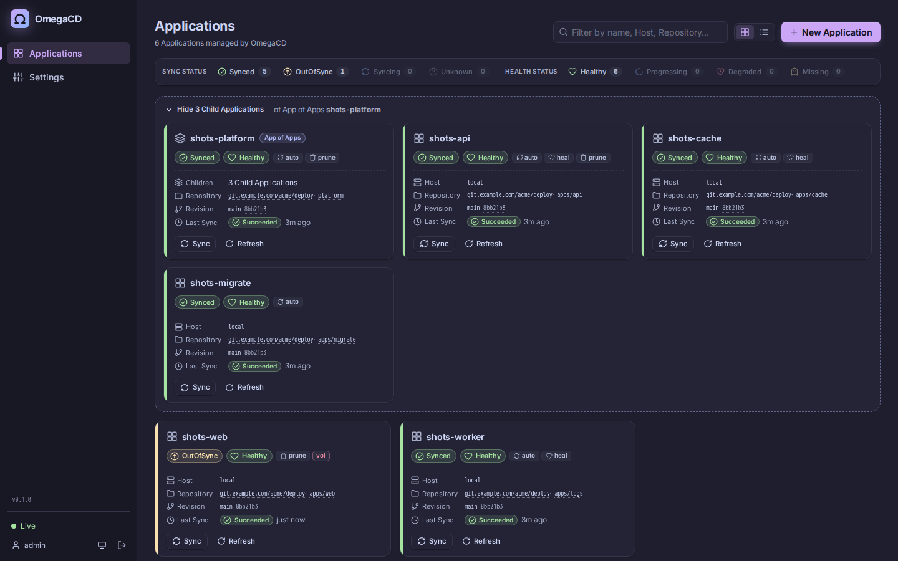
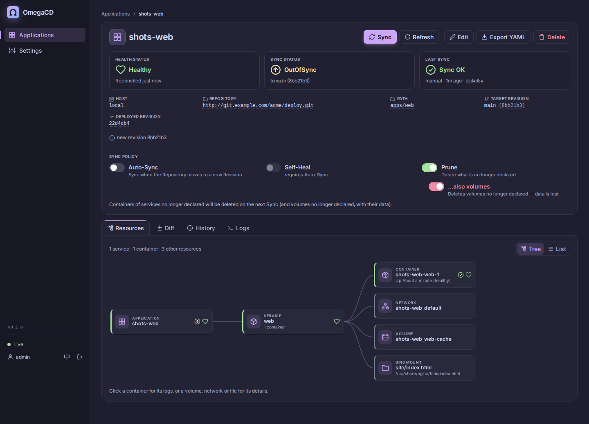
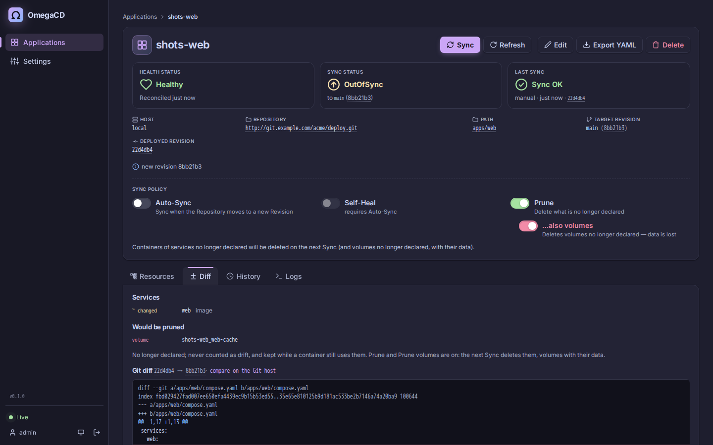
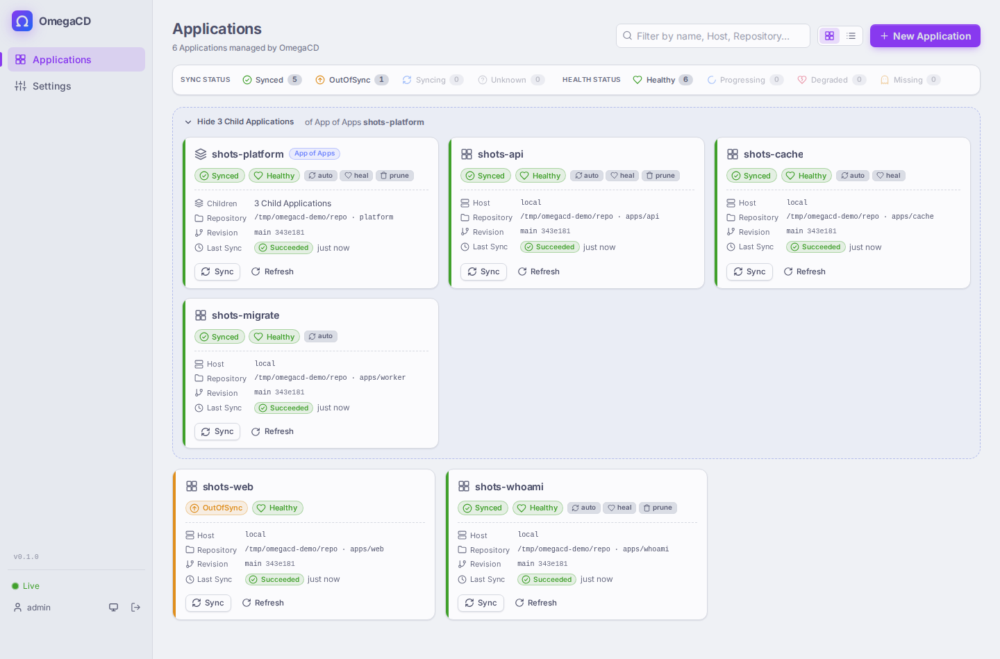
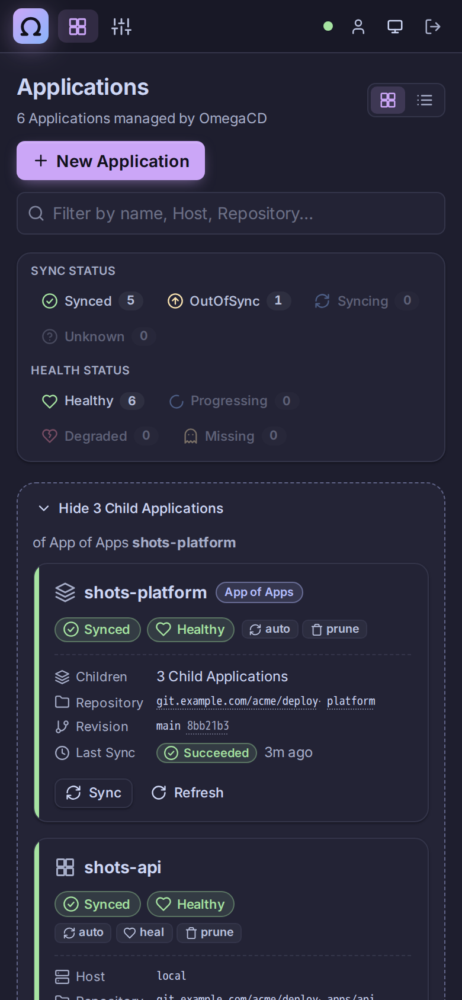
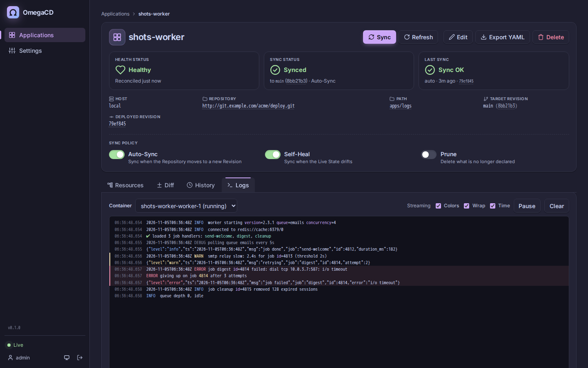
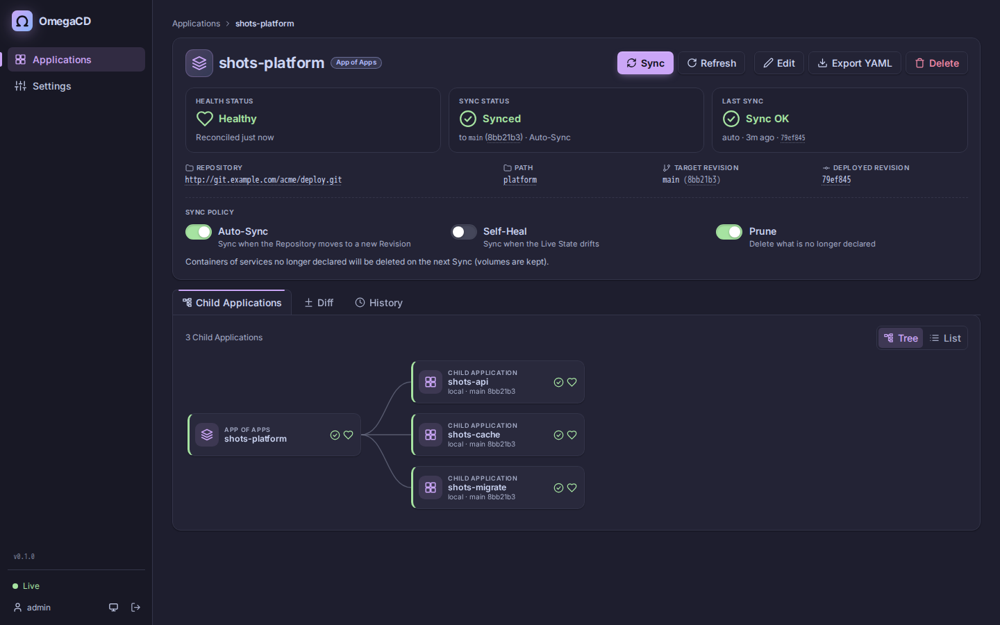
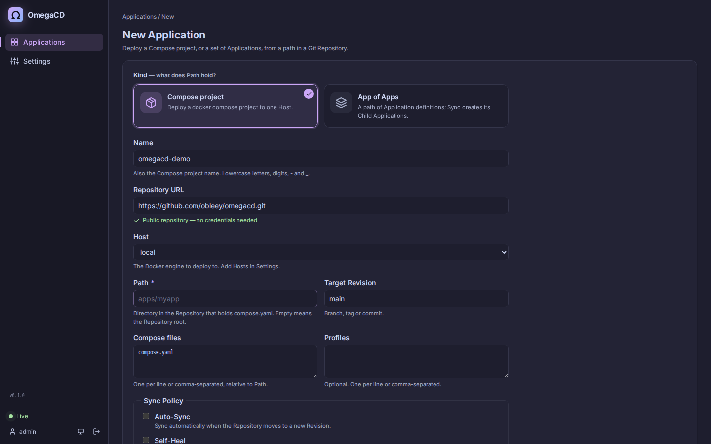
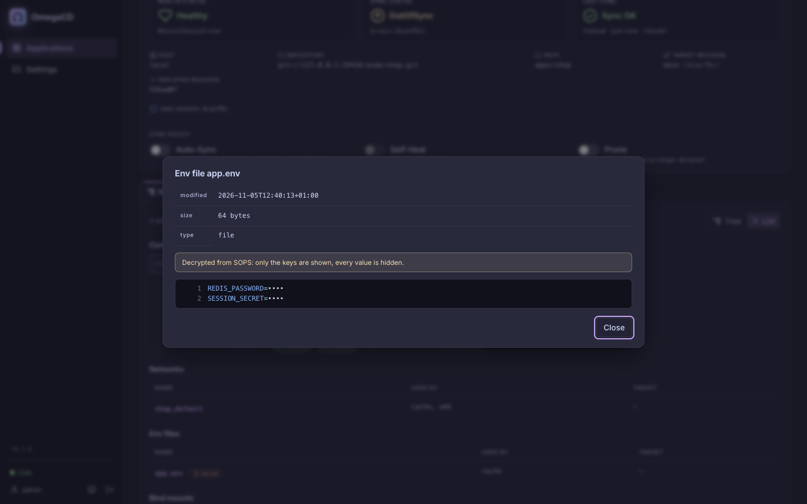
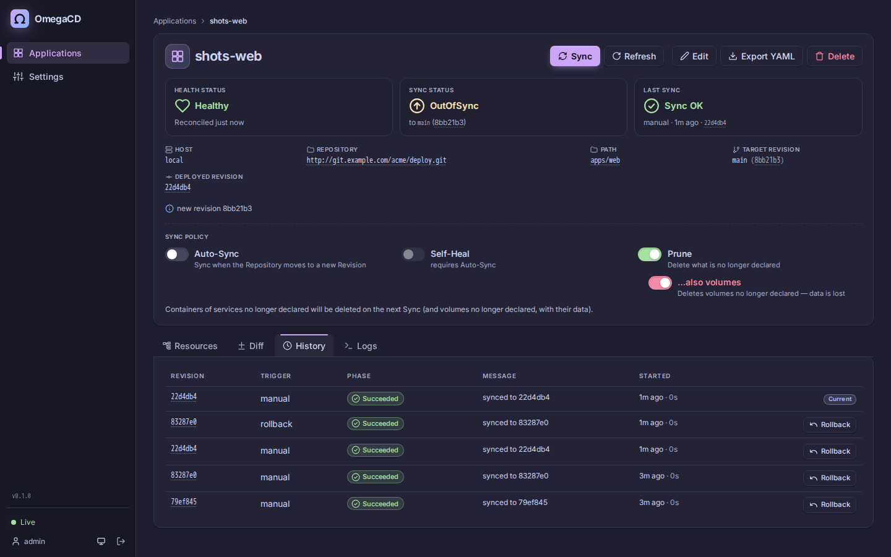

<p align="center">
  
</p>

<p align="center">
  <b>GitOps continuous delivery for Docker Compose hosts.</b>
</p>

<p align="center">
  <a href="https://github.com/obleey/omegacd/actions/workflows/ci.yml"></a>
  <a href="LICENSE"></a>
  <a href="https://github.com/obleey/omegacd/releases/latest"></a>
  <a href="https://github.com/obleey/omegacd/pkgs/container/omegacd"></a>
</p>

OmegaCD watches Git repositories and keeps Docker Compose projects on your Docker hosts in line with what is committed. Point an **Application** at a path in a repo; OmegaCD shows whether it is in sync and healthy, shows the diff, and syncs it — manually, or automatically on every push.



> **Status: early.** OmegaCD works and is tested against real Docker engines, but it is young and the API may still change. Feedback, bug reports and ideas are very welcome — please [open an issue](https://github.com/obleey/omegacd/issues).

## Why

Plenty of apps run on plain Docker hosts — a VPS, a homelab box, a few servers for a small team or an agency's clients — with no Kubernetes in sight. Deploying usually means SSH-ing in and running `git pull && docker compose up -d`, and nobody can say for sure what is running, what changed, or how to get back to yesterday's version. OmegaCD makes Git the answer:

- **Git is the single source of truth.** What is committed is what runs; a deploy is a commit.
- **See the diff before you deploy.** Per-service changes and the Git diff between the deployed and the target Revision.
- **Drift detection and Self-Heal.** A container changed or removed by hand shows up as OutOfSync, and OmegaCD can put it back.
- **History and Rollback.** Every Sync is recorded; roll back to any earlier Revision.
- **Secrets encrypted in Git.** SOPS + age files live next to your compose files and are decrypted only on the Host, by its Agent.
- **Many hosts from one place.** Every Host runs a small Agent that dials out to OmegaCD — no SSH into your servers, and its Applications keep running while OmegaCD is down. One UI, API and CLI for all of them.

It stays small: one binary — OmegaCD, and on each Host the same binary as its Agent — no database server, and your compose files unchanged. OmegaCD runs Compose as a library, so whatever `docker compose up` accepts works (except `build:` — build images in CI; OmegaCD pulls and runs them).

**Inspired by** the GitOps tools of the Kubernetes world — [Argo CD](https://argo-cd.readthedocs.io/) and [Flux](https://fluxcd.io/) — and the [OpenGitOps principles](https://opengitops.dev/) (declarative, versioned and immutable, pulled automatically, continuously reconciled), brought to Docker Compose. OmegaCD is an independent project, not affiliated with Argo CD, Flux or the CNCF.

## Features

- **Applications** — a Compose project (one or more compose files, optional profiles) at a path in a Git repo, tracking a branch, tag or commit, deployed to one Host
- **Sync Status and Health Status** — Synced / OutOfSync / Unknown; Healthy / Progressing / Degraded / Missing / Unknown — live over Server-Sent Events, resynced after reconnects
- **Sync Policy** — manual Sync, or Auto-Sync on new commits, Self-Heal on drift, and Prune
- **Diff** — Live (the compose files on the Host) and Desired (the compose files in Git) side by side and as a Compose diff, plus the per-service changes and the Git diff between the deployed and the target Revision
- **History and Rollback** — every Sync Operation is recorded; roll back to any earlier Revision
- **App of Apps** — declare Applications in Git; one parent Application creates, updates and deletes its children
- **Hosts** — each runs an Agent (Docker or Podman, rootful or rootless) that connects out to OmegaCD; enrolled with a single-use invite and an approved key fingerprint
- **Secrets** — SOPS + age encrypted files in Git, decrypted only on the Host, with a Host Key that never leaves it
- **Change detection** — Git polling plus GitHub, GitLab and Gitea/Forgejo webhooks, and a generic one for anything else
- **Web UI** — resource tree, diffs, colored live container logs, syntax colors for compose and config files (YAML, .env, nginx, Apache, Caddyfile, TOML, Markdown… ~240 formats via Shiki), repository access check while creating an Application, links to the Git host, light/dark/system theme, works on phones
- **CLI and API** — REST API with API tokens; a CLI for scripts and CI (`omegacd app sync myapp --wait`)
- **Prometheus metrics** at `/metrics`

| Application detail: resource tree and Sync Policy | Compose diff of a pending change |
| --- | --- |
|  |  |

| Light theme | On a phone |
| --- | --- |
|  |  |



## Install

OmegaCD (the Control Plane) makes an [age](https://github.com/FiloSottile/age) key at its first start, the Master Key: it seals the registry credentials OmegaCD stores, so **back it up** apart from the data directory. OmegaCD deploys nothing itself: every machine that runs Applications, the one OmegaCD runs on included, is a [Host](#hosts) with an Agent.

**Quick install** — on a Linux server with Docker:

```sh
curl -fsSL https://github.com/obleey/omegacd/releases/latest/download/install.sh | sh
```

[`install.sh`](deploy/install.sh) asks **full** (OmegaCD itself) or **agent** (a [Host's](#hosts) Agent). Full mode asks for the folder and the port, starts OmegaCD with Docker Compose and prints the URL and the first admin password, which you change at the first login; then open the UI and add a Host. Agent mode takes OmegaCD's address and an invite (Hosts → Add Host shows the line with both filled in) and installs the Agent for the engine it finds (install Docker or Podman first; on Debian with its recommended packages, as apt does by default: a minimal image without them lacks the `docker` command and Podman's networking): the [`.deb`](#option-2-binary--systemd)'s systemd service where apt is there (as its own user with rootful Docker, as you with rootless Docker or Podman), or [in a container](#the-agent-in-a-container). Run it as the user whose Docker or Podman the Agent uses; it asks for `sudo` where it needs root. Each release has its own `install.sh`, which installs that release; running it again upgrades to it and keeps the keys and settings. It runs unattended with the settings listed at its top (`OMEGACD_MODE`, `OMEGACD_PORT`, `OMEGACD_AGENT_CONTROL_PLANE`, …). The options below do the same by hand.

### Option 1: Docker Compose (recommended)

Download [`deploy/compose.yaml`](deploy/compose.yaml): OmegaCD and its [Source Server](#standalone-source-server) as two services, both as the image's `omegacd` user (uid 10001), never root, and no Docker socket: OmegaCD deploys through Agents. Their mTLS certificates are made at the first start and kept; the Master Key too, in the `omegacd-keys` volume. Every setting has a default you can override with environment variables or a `.env` file next to it: `OMEGACD_IMAGE` (pin a release), `OMEGACD_PORT`, `OMEGACD_DATA` (a folder owned by uid 10001 instead of the volume).

```sh
curl -fsSLO https://raw.githubusercontent.com/obleey/omegacd/main/deploy/compose.yaml
docker compose up -d
docker compose exec omegacd cat /data/initial-admin-password   # the first admin password: change it at the first login
```

Back up the Master Key (`age.key` in the `omegacd-keys` volume) and the Source Server's `source.key` (in `source-data`) apart from [`omegacd backup`](#backup-and-recovery)'s files: without them, registry and Git credentials have to be entered again.

Open http://localhost:8080, log in as `admin` with the password from the log, and set a new password (required on first login). Put OmegaCD behind a TLS-terminating [reverse proxy](#reverse-proxy) before exposing it.

Then [add a Host](#hosts) — this machine too, if Applications should run on it.

**Upgrade:** bump the image tag (or `docker compose pull` for `latest`) and run `docker compose up -d`. Data lives in the `omegacd-data` and `source-data` volumes.

**From v0.1:** there is no migration. v0.2 refuses a v0.1 database with a message and leaves it untouched: export each Application's definition with v0.1's `omegacd app export`, start v0.2 with a new data directory, enroll an Agent on each Host and create the Applications again (naming their `host:`); running stacks are taken over by name.

### Option 2: Binary + systemd

On Debian or Ubuntu, install the `.deb` from [GitHub Releases](https://github.com/obleey/omegacd/releases) (`amd64` or
`arm64`): `/usr/bin/omegacd`, the Control Plane's unit and the [Agent's](#the-agent-with-systemd). Verify it, install
it, then enable the Control Plane, which the package doesn't do by itself:

```sh
VERSION=v0.2.0 ARCH=amd64
curl -LO https://github.com/obleey/omegacd/releases/download/$VERSION/omegacd_${VERSION}_linux_${ARCH}.deb
curl -LO https://github.com/obleey/omegacd/releases/download/$VERSION/SHA256SUMS
sha256sum --ignore-missing -c SHA256SUMS
sudo apt install ./omegacd_${VERSION}_linux_${ARCH}.deb
sudo systemctl enable --now omegacd
sudo cat /var/lib/omegacd/initial-admin-password   # the first admin password: change it at the first login
```

It runs as the system user `omegacd`, with its data in `/var/lib/omegacd`. The Master Key, `/etc/omegacd/keys/age.key`,
is created at the first start (logged with its path); keep a copy apart from your backups (see
[Backup and recovery](#backup-and-recovery)). The unit is
[`packaging/omegacd.service`](packaging/omegacd.service); further settings (webhook secret, trusted proxies, …) go into
`/etc/omegacd/omegacd.env` (mode 0600).

**Upgrade:** `sudo apt install` the newer `.deb`; it restarts what runs. `apt remove` stops it and keeps everything;
`apt purge` also removes the Agent's state, but never the Control Plane's data, its Master Key or the system users.

Elsewhere, the `linux_amd64` and `linux_arm64` archives hold the binary alone: put it at `/usr/bin/omegacd` and the units
from [`packaging/`](packaging/) into `/etc/systemd/system/`, with a system user `omegacd` and `/etc/omegacd/keys` owned
by it.

### Option 3: CLI only

For laptops and CI, download the `darwin_*` or `linux_*` archive from [Releases](https://github.com/obleey/omegacd/releases) and put `omegacd` on your `PATH`. It is the same binary as the server — see [CLI](#cli).

### Reverse proxy

OmegaCD serves plain http on 8080; put a proxy with TLS in front before anyone else reaches it. Agents on other machines need it: they take `https://` only, plain `http://` only on loopback. [`deploy/proxy`](deploy/proxy) has one Compose override each for **Caddy** (automatic HTTPS), **Traefik** (Let's Encrypt) and **nginx** (your certificate, e.g. certbot's), all tested; fetch the folder next to `compose.yaml`, set what its file names at the top in `.env`, and start both together:

```sh
echo OMEGACD_DOMAIN=omegacd.example.com >> .env
docker compose -f compose.yaml -f proxy/caddy.yaml up -d
```

Each puts the proxy and the Control Plane on a network of their own, the proxy at a fixed address, and trusts `X-Forwarded-For` from that address alone (`OMEGACD_TRUSTED_PROXIES`), so the client's address is the real one for login throttling and [`host allow`](#hosts-and-keys) and nobody can claim another. The Control Plane's own port stays open on `127.0.0.1` for an Agent on the same machine. If `172.30.255.0/29` clashes with a network you have, set `OMEGACD_PROXY_NET` (e.g. `172.30.254`). WebSockets and event streams pass through all three; the Agents ping every 30 s, so idle timeouts of a minute or more (nginx's 60 s) don't cut them.

**A proxy you already run** (one Traefik or Caddy for every site on the machine): attach `omegacd` to its network, route your domain to `omegacd:8080`, and set `OMEGACD_TRUSTED_PROXIES` to the proxy's address, or that network's subnet, knowing every container on it is then trusted to name a client.

**Behind Cloudflare** (proxied DNS in front of your proxy): nothing changes for OmegaCD; WebSockets pass and API tokens reach it. Your proxy sees Cloudflare's edge as the client: let it restore the real one (Cloudflare's `CF-Connecting-IP`, or its [address ranges](https://www.cloudflare.com/ips/) as trusted proxies in Caddy or nginx's `real_ip`), or add those ranges to `OMEGACD_TRUSTED_PROXIES`, if `host allow` or login throttling should see real clients. With **Cloudflare Access** in front, keep it to the UI: a Bypass rule for `/api/agents/`, `/api/webhooks/` and API-token calls to `/api/`, which can't log in with a browser (or give the CLI a service token).

A proxy between the Control Plane and a [standalone Source Server](#standalone-source-server) must pass TLS through: see there.

### Kubernetes

Not in v0.2: OmegaCD is for Docker hosts, and its Control Plane runs on one with Docker Compose. A Kubernetes manifest comes after v0.2 ([ROADMAP](ROADMAP.md)).

### Versions

The version is always the Git release tag: pushing tag `v0.1.0` builds and stamps the binaries (`omegacd version` → `omegacd v0.1.0`) and the image (`ghcr.io/obleey/omegacd:0.1.0`, `:0.1` and `:latest`). The server reports it at `GET /api/version`, and the UI shows it in the sidebar and on the login page.

## Your first Application

This repository has a ready example, [`examples/hello`](examples/hello): nginx serving a page that lives in Git. It runs on a [Host](#hosts): enroll an Agent on the machine you want it on first. The examples call that Host `local` — any name works; this machine is a Host like any other:

```sh
omegacd host add local      # prints the command that starts its Agent, with a single-use invite
# run that command on the machine, then approve the fingerprint it prints:
omegacd host approve local SHA256:…
```

```yaml
# examples/hello/compose.yaml
services:
  web:
    image: nginx:1.29-alpine
    ports:
      - "8081:80"
    volumes:
      - ./index.html:/usr/share/nginx/html/index.html:ro # a file from Git, restored on every Sync
    restart: unless-stopped
```

**In the UI:** **New Application** → name `hello`, repository `https://github.com/obleey/omegacd`, path `examples/hello`, Host `local`, turn on **Auto-Sync**, **Create**. OmegaCD deploys it within seconds; open http://localhost:8081 (or the server's address). The Application page shows its containers, the Diff, History and Logs.

**With the CLI** (`omegacd login` first, see [CLI](#cli)):

```sh
omegacd app create hello --repo https://github.com/obleey/omegacd --path examples/hello --host local --auto-sync
omegacd app wait hello --sync --health
```

**Make it yours:** copy `examples/hello` into your own repository, point the Application at it, change `index.html` and push — OmegaCD sees the new commit (on the next poll, or within seconds [with a webhook](#webhooks)) and recreates the container with the new page. Add a `.sops.env` next to it for [secrets](#secrets).

### Your first App of Apps

Instead of creating each Application by hand, declare them in Git. [`examples/apps.yaml`](examples/apps.yaml) defines two: `hello` (Auto-Sync on) and [`whoami`](examples/whoami) (Auto-Sync off — it waits for a Sync):

```yaml
# examples/apps.yaml
name: hello
repoURL: https://github.com/obleey/omegacd.git
path: examples/hello
host: local
autoSync: true
selfHeal: true
---
name: whoami
repoURL: https://github.com/obleey/omegacd.git
path: examples/whoami
host: local
autoSync: false
```

**New Application** → name `examples`, kind **App of Apps**, repository `https://github.com/obleey/omegacd`, path `examples`, **Create**, then **Sync** it (or `omegacd app create examples --repo https://github.com/obleey/omegacd --path examples --kind apps && omegacd app sync examples --wait`). The Sync creates both Child Applications and deploys them — http://localhost:8081 and http://localhost:8082. From then on a new commit deploys `hello` by itself, while `whoami` shows *OutOfSync* until you Sync it (or the App of Apps). In your own repository, one folder of definitions like this per server describes everything that runs there; see [Defining Applications](#defining-applications) for every field.

## Concepts

| Term | Meaning |
| --- | --- |
| **Application** | A Compose project whose desired state lives at a path in a Git repository and is deployed to one Host. |
| **App of Apps** | An Application whose path holds Application definitions instead of compose files. Syncing it creates and updates its Child Applications, and with Prune deletes those no longer declared. It deploys nothing itself and has no Host: each Child Application names its own, so one App of Apps can span several Hosts. |
| **Child Application** | An Application declared in an App of Apps. Its settings are owned by Git, not the UI. It is rolled back as any Application; while rolled back, its App of Apps' Syncs leave it alone (Auto-Sync off) until a Sync of it, after which its App of Apps applies Git's settings again. One adopting a running stack waits for its first manual Sync, after its Diff. A manual Sync of the parent also syncs children that are OutOfSync or whose last Sync failed; a Refresh of the parent refreshes all children. |
| **Host** | A machine Applications are deployed to, through its Agent: `omegacd agent`, enrolled with `omegacd host add`. The machine OmegaCD runs on is a Host like any other. |
| **Sync** | Making the running containers match the compose files at the target Revision (commit). Each attempt is a Sync Operation, recorded as Running, Succeeded or Failed. |
| **Sync Status** | **Synced**, **OutOfSync** (Live State differs, or a new Revision is waiting), or **Unknown** (the desired state cannot be determined, e.g. Git is unreachable). |
| **Health Status** | **Healthy**, **Progressing**, **Degraded**, **Missing**, or **Unknown** (its Host's Agent hasn't reported it), from container state and healthchecks, as the Agent reports them. A container that exited 0 counts as Healthy (one-shot jobs) — unless its service has a restart policy, then it is long-running and stopped means Degraded. |
| **Rollback** | A Sync to an earlier Revision from the history. It turns Auto-Sync off so the next commit does not undo it; a manual Sync to the target Revision ends it. |

**Sync Policy**, per Application:

- **Auto-Sync** — Sync whenever the repository moves to a new Revision.
- **Self-Heal** — also Sync when the Live State drifts without a new commit (a container was stopped, removed or changed by hand). Requires Auto-Sync.
- **Prune** — what happens to services no longer declared (removed from the compose files, or their profile switched off): with Prune **off**, a Sync *stops* their containers; with Prune **on**, it *deletes* their containers and the project networks no longer declared (a network still used by any container is kept and shown as prune pending). Volumes are kept. Prune is also available as a one-off Sync option.
- **Prune volumes** — a sub-option of Prune (off by default, and turned off with Prune): a Sync also *deletes* the project's named volumes no longer declared, **with their data**, unless a container (of any project, even a stopped one) still uses them. External volumes, volumes OmegaCD's Compose project did not create, volumes of profile-disabled services and host paths are never touched. The Diff tab lists undeclared networks and volumes under *Would be pruned*; they never make an Application OutOfSync.

**Change detection.** Compose recreates a container when its service definition changes. OmegaCD additionally hashes the *content* of file-based `configs:` and `secrets:` and of bind-mounted regular files inside the Application's path into a `dev.omegacd.content-hash` label — so editing `nginx.conf` in Git recreates the container that mounts it, and shows up as OutOfSync until synced. Images are pulled by each service's `pull_policy` (Compose default: only when missing) — push a new tag rather than overwriting one.

## Defining Applications

Create Applications in the UI (**New Application**), with the CLI, or declaratively in Git with an **App of Apps**. Point an Application with kind *App of Apps* at a directory of definitions; every `*.yaml` / `*.yml` file directly in it may hold several documents:

```yaml
# platform/apps.yaml — the path of the App of Apps "platform"
name: web
repoURL: https://github.com/acme/deploy.git
path: apps/web                 # directory with the compose files
targetRevision: main           # branch, tag or commit
composeFiles: [compose.yaml]   # default: the first of compose.yaml, compose.yml, docker-compose.yaml, docker-compose.yml
profiles: [prod]               # optional Compose profiles
host: edge-01                  # required: the Host whose Agent deploys it
autoSync: true
selfHeal: true
prune: true
pruneVolumes: false            # with prune: also delete volumes no longer declared (data is lost)
workDir: /srv/apps             # optional: the Host's folder for its files, under a root the Agent
                               # allows (OMEGACD_AGENT_WORKDIR_ALLOW); default the Agent's work dir. Not inherited
---
name: cache
repoURL: https://github.com/acme/deploy.git
path: apps/cache
host: edge-01
autoSync: true
selfHeal: false
prune: false
```

`omegacd app export NAME` (or **Export YAML** in the UI) writes this format for an existing Application, and `omegacd app create -f FILE` reads it. Every Application names its `host:`: there is no default, and a definition without one fails the App of Apps' Sync, so nothing is deployed to a Host Git didn't name. Nested App of Apps are not supported. `adopt: true` lets an Application take over an existing, unmanaged Compose project of the same name.



**What each action does on an App of Apps:**

| Action | Order | Children |
| --- | --- | --- |
| **Refresh** | children first, then the App of Apps (its status sums up theirs) | all re-read Git — one Refresh after fixing a Git credential brings them all back |
| **Sync** (manual) | the App of Apps first (creates, updates, with Prune deletes the definitions), then children | only those OutOfSync or whose last Sync failed; Synced ones are not touched |
| **Auto-Sync** | the App of Apps only | each child follows its own Sync Policy |

The App of Apps shows the worst Health of its children.

**Recommended Sync Policies:**

- **The App of Apps:** Auto-Sync on, Prune **off**. A definition removed from Git then only marks its Application *not in Git* and keeps it running until you delete it — a bad commit can't take services down.
- **Stateless Applications** (proxies, dashboards, monitoring): Auto-Sync and Self-Heal on; a push deploys them.
- **Applications with a database** (WordPress, Forgejo, analytics): Auto-Sync off, or on without Prune — upgrades there often want a backup or a migration first.
- **Prune volumes** only where losing the data is fine; never on a database Application.

**Database migrations.** Use Compose's own init pattern: a one-shot service that runs the migration, and the app waiting for it to complete. OmegaCD runs the migration first and touches the rest only once it succeeded: a failing migration fails the Sync with its output and leaves the running app as it was.

```yaml
services:
  migrate:
    image: ghcr.io/acme/shop:1.4           # the app's own image
    command: ["php", "artisan", "migrate", "--force"]   # Django: python manage.py migrate; Rails: bin/rails db:migrate
    depends_on: {db: {condition: service_healthy}}
  app:
    image: ghcr.io/acme/shop:1.4
    depends_on: {migrate: {condition: service_completed_successfully}}
```

The migration runs on **every** Sync, and again when the Host restores the Application after a reboot, so it must be idempotent: running it twice changes nothing the second time. Laravel's, Django's and Rails' migrations are (they record what ran). A completed migration counts as Healthy and Self-Heal leaves it alone. A migration in a profile that is off, waited for with `required: false`, doesn't run, as with `docker compose up`. Something that should run once per change rather than on every Sync, like a backup before an upgrade, is a Sync hook ([Roadmap](ROADMAP.md)).

**Labels.** Every container OmegaCD creates carries `managed-by=omegacd` and `dev.omegacd.application=<name>` (on Docker and Podman alike), so `docker ps --filter label=managed-by=omegacd` lists everything OmegaCD manages. Containers created before an upgrade get the label on their next recreate.

## Where your data lives

Each Application has its own folder in its Host's work dir (the Agent's `OMEGACD_AGENT_WORKDIR`, or the Application's `workDir:`): `<work dir>/<name>`, or `<work dir>/<App of Apps>/<name>` for a Child Application (an App of Apps itself has no files). Its Agent makes that folder match Git on every Sync (files not in Git are deleted), so **data must not live there**. Only named volumes and absolute paths keep data:

| In your compose file | Where the data is | Kept across reboots, Syncs and deletes? |
|---|---|---|
| `- media:/data` (named volume) | Docker's volume storage | ✅ kept, even with Prune — deleted only by **Prune volumes** once no longer declared, or by deleting the Application with **Also delete its volumes** (`app delete --volumes`) |
| `- /opt/media/torrents:/data` (absolute path) | that folder **on the Host running the container** | ✅ OmegaCD never touches it; a missing folder is created by Docker (as root, so `chown` it for non-root images) |
| `- ./nginx.conf:/etc/nginx/nginx.conf:ro` | a file from Git | ✅ restored from Git; changing it recreates the container |
| `- ./app.yaml:/etc/app/app.yaml:ro` (from `app.sops.yaml`) | a file decrypted from an [encrypted one in Git](#secrets) | ✅ decrypted again on every Sync and after a reboot; a plain `app.yaml` in Git beside `app.sops.yaml` fails the Sync, as decrypting would replace it |
| `- ./conf.d:/etc/nginx/conf.d:ro` | a folder from Git | ✅ for config only: anything a container writes into it is deleted on the next Sync (a `.gitkeep` doesn't make it a data folder) |
| `- ./data:/data` (not in Git) | — | ⛔ **refused**: every Sync deletes files that are not in Git, so the Sync fails and asks for a named volume or an absolute path. The same goes for `../` paths |

Changes *inside* data folders and volumes never count as drift. Back up volumes and data folders yourself (e.g. restic or borg) — OmegaCD doesn't.

**Folders OmegaCD didn't create are never synced into.** A work dir like `/opt/services` may already hold other folders. A Sync writes into an Application's folder only if it is missing or empty (or holds only empty directories), if the Agent recorded that it wrote there for that Application, or if a container OmegaCD created for it (`managed-by=omegacd`) runs from it — containers of other tools don't count. An App of Apps' folder may also hold its children's folders. Anything else fails, naming the folder: rename the Application, pick another work dir, or move the folder away. Older versions marked their folders with a `.omegacd` file instead: a folder marked for the Application is still taken, and the Sync deletes the marker; one marked for another Application is refused.

## Backup and recovery

**History** (every Sync Operation) is kept forever unless you set `OMEGACD_HISTORY_KEEP` (the newest N per Application) or `OMEGACD_HISTORY_MAX_AGE` (e.g. `720h`); pruning runs at start and hourly, and never deletes an Application's deployed Sync Operation. The files OmegaCD delivered go with the history: those no Sync Operation uses any more are deleted hourly.

**Back up** the Control Plane while it runs:

```sh
omegacd backup omegacd-$(date +%F).tar     # owner-only; never overwrites a file
```

The tar holds the database and, with the built-in Source Server, its encrypted Git credentials (`credentials.age`). **No key is in it**: keep these two apart, safely, once:

| Key | Seals | Lost? |
|---|---|---|
| the Master Key (`OMEGACD_AGE_KEY_FILE`) | the registry credentials' passwords | enter the registry credentials again |
| `source.key` (in the data dir, or the standalone Source Server's) | the Git credentials | enter the Git credentials again |

Your Applications' secrets are not in either: each Host's Agent holds its own Host Key, on that Host. A standalone Source Server keeps its `credentials.age` and `source.key` in its own data dir: back those up the same way.

**Each Host's Agent keys**: back up `signing.key` and `host.key` from its state dir (e.g. `/var/lib/omegacd-agent`) once. A Host reinstalled with those two put back reconnects as itself, no enrollment: the Control Plane deploys its Applications again at their deployed Revisions, even with the Source Server down. Lost, the Agent can't get back on a Host that has Applications, and the Host Key can't decrypt the secrets in Git that were encrypted for it: re-encrypt them for the new one (`omegacd host key show HOST`).

**Restore** on a stopped Control Plane: an empty data dir, `tar -xf omegacd-….tar -C <data dir>`, `source.key` and the Master Key back where they were, start. The Agents reconnect by themselves. The files OmegaCD delivered aren't in the tar (Git has them): until the Source Server is reachable, Rollbacks work from what each Agent keeps (its last 10 Revisions per Application), and a reinstalled Host waits for the Source Server. A Sync the backup caught running, whose result reached only the Control Plane you lost, shows as **Unknown**; what runs is what each Agent reports.

**From nothing** (no backup): start an empty Control Plane, add each Host again and run its Agent with the new invite (its state is kept: its apps keep running; reports it kept for the old Control Plane are dropped). `omegacd host list` shows what each Host runs that OmegaCD doesn't know (**not managed**: never touched). Create your App of Apps again: an Application its Agent already runs at the target Revision is **taken over** without deploying (its history says so); one at another Revision Syncs normally.

## Git access

**Settings → Source Server** shows where it runs (in-process, or standalone at its address), whether it answers and
how fast, its version (warned when it doesn't fit OmegaCD's) and the size of its Repository and blob caches. A
standalone Source Server's log lines carry the Application and Sync Operation of each call (`app=… op=…`), so one
Sync reads through the Control Plane's, the Source Server's and the Agent's logs.

A file this Host can't decrypt fails the Sync with what to do: "app.sops.env can't be decrypted on this Host: it's
encrypted for age1abc…7x2c, not for this Host's key age1… Add that key to the file's rule in .sops.yaml and run sops
updatekeys on it", on the Application's page, in History and in `omegacd app sync --wait`.

A decrypted file (an env file from `app.sops.env`, say) shows its key names only, `API_TOKEN=••••`: OmegaCD reads
them from the encrypted file in Git, where SOPS leaves names readable. Its values are decrypted only on the Host and
never sent anywhere.

An Application may name its own **work dir**, the root for its folder on the Host (`workDir:` in its definition, the
form's Work dir field, `omegacd app create --work-dir`), under a root its Agent allows: its own work dir or one in
`OMEGACD_AGENT_WORKDIR_ALLOW`. The form and the API refuse one outside them when saving, in the Agent's words; a Host
card shows its roots. Changing it later deploys into the new folder and leaves the old one, data included.

Public repositories need no setup; the New Application form checks access as you type (public / private with a credential / denied, with an inline *Add credential*). For private ones, add a credential under **Settings → Repository credentials** (for reading Git repositories), matched by URL prefix: a username and password/token for HTTPS, or an SSH private key. Credentials are kept by the [Source Server](#standalone-source-server), not in OmegaCD's database: in `credentials.age` in its data dir, encrypted with its own key `source.key` (created at its first start, owner-only). Back up both together; without `source.key` the credentials can't be read. Secrets go in and are never shown again. Private images need **Settings → Registry credentials** (for pulling Docker images), keyed by registry host such as `ghcr.io` — not a URL.



SSH host keys are always verified against the `known_hosts` file (`OMEGACD_SSH_KNOWN_HOSTS`, default `/etc/omegacd/known_hosts`):

```sh
ssh-keyscan github.com gitlab.com >> known_hosts   # verify the fingerprints against your provider's docs
```

## Hosts

Every Host runs an Agent: the same binary, as `omegacd agent`. It dials out to OmegaCD over one WebSocket — https only, except to its own machine — so nothing connects into your servers; it deploys with the Host's Docker or Podman, decrypts its secrets, reports Health, containers and logs, and keeps its Applications running and self-healing while OmegaCD is down.

```sh
omegacd host add web-1                       # prints the command that starts its Agent, with a single-use invite (an hour)
# on the server, as a user of its container engine (docker group, or rootless Docker or Podman):
OMEGACD_AGENT_CONTROL_PLANE=https://omegacd.example.com OMEGACD_AGENT_INVITE=omegacd-invite-… omegacd agent
omegacd host approve web-1 SHA256:…          # after comparing the fingerprint the Agent printed with host list's
```

In the UI it is **Hosts → Add Host**: name the Host, copy the commands that run its Agent (`install.sh`'s one-liner,
in a container with [`deploy/agent.yaml`](#the-agent-in-a-container), or the command line with `omegacd` installed), and
watch it connect; compare the fingerprint it shows with the one
the Agent printed, and **Approve**. **Cancel** removes the Host with its invite (and the key of an Agent that enrolled
meanwhile); **Close** leaves it waiting for its Agent. Agents connect over https only: open OmegaCD at the address they reach it at.
Each Host then has a card, live: online or last seen, its Agent's version (flagged **outdated** when older than
OmegaCD), engine and rootless, OS/arch, its Applications (each a link, with a dot in its status color, grouped by the App of Apps that declares them), its key's fingerprint and its Host Key with its `.sops.yaml`
rule to copy; and **Rotate key**, **Allowlist…** (showing the address its Agent last connected from), **Rename…**
(only while no Application uses it), **Revoke**, and for a locked Host both connections with **Unlock**.

Wherever an Application shows (its tile, its row, its page), its Host's name comes with its engine
(`obleey-macbook · Docker 29.8.2`), and badges say what needs attention: **Host offline**, **Agent outdated**,
**Rolled back on the Host** (with `omegacd agent rollback`) and **Sync queued**; each tooltip says what it means and
what to do. The tiles are one grid, as in Argo CD: an App of Apps is a tile with its child count, and each child names
it (**↳ platform**).

While a Host is offline its Applications show what its Agent last reported, dimmed and "as of" when, with since when
the Host is offline; a Sync waits for it (**Sync queued**) and is cancelled with **Cancel** on the Last Sync card or in
History, or `omegacd app cancel NAME`. Logs come only from the Agent: OmegaCD stores none. A container's uptime
("Up 2 h 14 min", "Exited (1) 5 min ago") counts on live from the start time its Agent reports.

**Settings → Display** picks how dates and times are shown, in this browser: the browser's own format, European
(`17.11.2026 18:42`) or US (`11/17/2026 6:42 PM`).

Applications with `host: web-1` then deploy through it; a Sync to it while it's offline waits for it, and its Applications show their last known state. `omegacd agent --help` lists its settings (its work dir, state dir, engine). The machine OmegaCD runs on is a Host like any other: give it an Agent too, and OmegaCD can deploy its own Compose project as an Application — an Agent only refuses the project it runs in itself.

### The Agent in a container

[`deploy/agent.yaml`](deploy/agent.yaml) runs the Agent as the image's `omegacd` user in the engine socket's group,
never root, on host networking, so an Agent beside its OmegaCD reaches it at `http://127.0.0.1:8080`. Next to it, a
`.env` (Add Host fills it in):

```sh
OMEGACD_AGENT_CONTROL_PLANE=https://omegacd.example.com
OMEGACD_AGENT_INVITE=omegacd-invite-…               # ignored once the Agent is enrolled
OMEGACD_DOCKER_GID=$(stat -c %g /var/run/docker.sock)
```

`docker compose up -d`, then approve its fingerprint. Its work dir (`/run/omegacd`, in RAM) is mounted at the same path
on both sides, as the engine resolves the Applications' bind mounts on the Host: the Agent refuses another path, and
takes the folder back when Docker made it as root after a reboot. Its keys are in the `omegacd-agent` volume: back up
`signing.key` and `host.key`. With **rootless Docker or Podman** the engine's root in a container is your own user on
the Host, so the Agent runs as that: `OMEGACD_AGENT_USER=0:0`, `OMEGACD_DOCKER_GID=0`, your socket in
`OMEGACD_DOCKER_SOCK` (`/run/user/1000/docker.sock`, Podman's `/run/user/1000/podman/podman.sock`) and a work dir under
it in `OMEGACD_AGENT_WORKDIR` (`/run/user/1000/omegacd`). Anywhere else the Agent refuses to run as root. Rootless
Docker's host network has a loopback of its own, so there the Agent takes OmegaCD's `https://` URL even on the same
machine (a private CA: `OMEGACD_AGENT_CA_FILE`, with the file mounted); or run it as a
[user unit](#the-agent-with-systemd) instead.

### The Agent with systemd

`install.sh` in agent mode does what follows (see [Quick install](#install)). The `.deb` (see
[Binary + systemd](#option-2-binary--systemd)) has the Agent's units. With **rootful Docker**, its system
unit runs the Agent as its own user, `omegacd-agent`, in the `docker` group, never root. The package enables it; it
starts once its settings are there:

```sh
sudo apt install ./omegacd_${VERSION}_linux_${ARCH}.deb
printf 'OMEGACD_AGENT_CONTROL_PLANE=%s\nOMEGACD_AGENT_INVITE=%s\n' https://omegacd.example.com omegacd-invite-… |
  sudo install -m 0640 -g omegacd-agent /dev/stdin /etc/omegacd/agent.env
sudo systemctl start omegacd-agent
journalctl -u omegacd-agent | grep fingerprint         # approve it in the UI
```

Its keys and cache are in `/var/lib/omegacd-agent` (back up `signing.key` and `host.key`), its work dir is
`/run/omegacd`, in RAM, and stays while the Agent restarts or upgrades. After a reboot Docker restarts containers before
the Agent runs, and would make their missing files root-owned folders: `omegacd-agent-restore` puts the files back
first, decrypted from the Agent's cache, so every app comes back as it was, OmegaCD reachable or not. Further settings
(`omegacd agent --help`) go into `agent.env`; `omegacd agent rollback` runs as the Agent's user with its settings:
`sudo -u omegacd-agent sh -c 'set -a; . /etc/omegacd/agent.env; STATE_DIRECTORY=/var/lib/omegacd-agent omegacd agent rollback'`.
Upgrading the package restarts the Agent; the apps run on. `apt purge` removes its keys and state too: the Host is then
enrolled again.

With **rootless Docker or Podman**, the package's user units run it as you, lingering so it starts with the machine:

```sh
mkdir -p ~/.config/omegacd
(umask 077; printf 'OMEGACD_AGENT_CONTROL_PLANE=%s\nOMEGACD_AGENT_INVITE=%s\n' https://omegacd.example.com omegacd-invite-… \
  > ~/.config/omegacd/agent.env)
echo "DOCKER_HOST=unix://$XDG_RUNTIME_DIR/podman/podman.sock" >> ~/.config/omegacd/agent.env   # Podman only
sudo loginctl enable-linger "$USER"
systemctl --user enable omegacd-agent-restore && systemctl --user enable --now omegacd-agent
```

Its keys are in `~/.local/share/omegacd-agent`, its work dir is `$XDG_RUNTIME_DIR/omegacd`, and the restore unit runs
before rootless Docker's `docker.service` and Podman's `podman-restart.service` (enable it for containers with
`restart: always` to come back at boot). **Podman** also needs its events and logs in files, which Self-Heal reads,
with the logs capped: copy `/usr/share/omegacd/containers.conf.d/omegacd-agent.conf` (from
[`packaging/containers.conf.d/`](packaging/containers.conf.d/omegacd-agent.conf)) into
`~/.config/containers/containers.conf.d/`, then `systemctl --user restart podman.socket`.

Without the package, the units are in [`packaging/`](packaging/): the system ones into `/etc/systemd/system/` with the
user `omegacd-agent` made by hand, the user ones into `~/.config/systemd/user/`, and the binary at `/usr/bin/omegacd`.

## Secrets

Commit secrets encrypted with [SOPS](https://github.com/getsops/sops) for the **Host Key** of the Host the Application deploys to, and for the **people's keys** allowed to open and edit them. Each Host's Agent makes its own age key when it enrolls and keeps it in its state dir; only its public half reaches OmegaCD, so OmegaCD can decrypt nothing, and a key leaked from one server exposes only that server's secrets. Back up each Agent's state dir: it holds the Host Key.

A file encrypted for a Host alone can be opened by no person again, so each person who edits secrets has a key of their own, on OmegaCD's key list:

```sh
omegacd keygen                                 # your key, where sops reads it (~/.config/sops/age/keys.txt on Linux,
                                               # ~/Library/Application Support/sops/age/keys.txt on macOS); prints its public half
omegacd secrets key add ana age1…              # the admin adds it, for all Hosts (or --host web --host db); or Settings → Encryption keys
```

Then, in your repository's checkout, `omegacd secrets init` writes a `.sops.yaml` rule for each Application of a Host, with its Host Key and the people's keys covering that Host, and `sops` encrypts by it:

```sh
omegacd secrets init --host prod               # one rule per Application of prod from this repository; --path DIR for more
sops encrypt --in-place apps/shop/.sops.env    # or sops edit apps/shop/.sops.env
```

```yaml
# .sops.yaml, as secrets init writes it (your own rules stay, after OmegaCD's)
creation_rules:
  # omegacd: Host prod
  - path_regex: ^apps/shop/.*\.sops\.
    age: age1…,age1…   # the Host Key of prod, then ana's
```

The **Hosts** page shows each Host's public key and copies a ready rule for it (**Copy .sops.yaml for all Hosts** gives one per Host), with the people's keys too; `omegacd host key show HOST` prints the key.

When the key list changes, or a Host's key does, run `omegacd secrets rekey` in the checkout and commit: it refreshes the rules OmegaCD wrote and re-encrypts every secret file for them with your key, the values unchanged. It lists the files it can't open (encrypted only for keys you don't hold, such as a Host's alone): write those values again. Until then, an Application whose files are encrypted for an outdated set of keys warns in its Diff.

- **Keep one key offline** (made with `omegacd keygen --out recovery.key`, stored safely) on the list for recovery. With the list empty, only the Hosts can decrypt: nobody can edit the secrets, and a lost Host loses them; `secrets init` and `import` refuse that unless you pass `--host-only`.
- **The list decides who can read the secrets, not who can change them**: anyone who can push to the repository can encrypt a new value with a Host's public key. Who may change production is decided in Git (branch protection, reviews).
- **When someone leaves**, remove their key and rekey, then **change the secret values**: old commits stay readable to the removed key.
- **A Host whose keys are lost** gets a new Host Key: with Applications, forget them (`app delete NAME --forget`), delete the Host and add it again, create the Applications again, and rekey. Deleting a Host takes it off the keys that named it.

Decryption uses age keys only: files encrypted solely with PGP or a cloud KMS are not decrypted.

A file its Host's key can't decrypt fails the Sync, naming the keys it is encrypted for.

Any file whose name contains `.sops.` is decrypted by the Agent at Sync time, with `.sops.` removed from the name — `app.sops.env` becomes `app.env`, `db-password.sops.txt` becomes `db-password.txt`. The work dir keeps only the decrypted file, which is what the containers read; the encrypted one stays in Git:

```sh
sops encrypt --age age1... --input-type dotenv --output-type dotenv app.env > app.sops.env
sops encrypt --age age1... app.yaml > app.sops.yaml
sops encrypt --age age1... --input-type binary --output-type binary db-password.txt > db-password.sops.txt
rm app.env app.yaml db-password.txt   # commit only the .sops. files
```

```yaml
services:
  app:
    image: ghcr.io/acme/app:1.4.2
    env_file: app.env          # decrypted from app.sops.env
    volumes:
      - ./app.yaml:/etc/app/app.yaml:ro   # decrypted from app.sops.yaml
    secrets: [db_password]
secrets:
  db_password:
    file: ./db-password.txt    # decrypted from db-password.sops.txt
```

The format is taken from the decrypted file's extension: `.yaml`/`.yml`, `.json`, `.env`/`.dotenv`, `.ini`, anything else binary. Plaintext exists only in the Application's folder on its Host (mode 0600; the Agent's default work dir is under `/run`, a tmpfs on most Linux hosts) — never in Git, never on OmegaCD's side and never in the UI, which shows only the keys of decrypted env files:



### What reaches the disk

How a secret reaches the container decides where it ends up:

| In your compose file | Where the plaintext is |
| --- | --- |
| `env_file: app.env` or `${VAR}` from a decrypted `.env` | the work dir, **and Docker's container configuration on disk** (`/var/lib/docker`, readable with `docker inspect`) — that is how Docker passes environment variables, with or without OmegaCD |
| `secrets: [db_password]` with `file: ./db-password.txt` | **only the work dir**: with the default `/run` it never touches disk; the app reads `/run/secrets/db_password` |

For a secret that must stay off disk, use a Compose secret file and, where the image supports it, a `*_FILE` variable (`MARIADB_PASSWORD_FILE: /run/secrets/db_password`).

## Webhooks

Polling (`OMEGACD_POLL_INTERVAL`, default 3m) always works; webhooks make Syncs start within seconds of a push. Add a push webhook pointing to:

| Provider | URL | Secret |
| --- | --- | --- |
| GitHub | `https://omegacd.example.com/api/webhooks/github` | "Secret" field, checked via `X-Hub-Signature-256` |
| GitLab | `https://omegacd.example.com/api/webhooks/gitlab` | "Secret token", checked via `X-Gitlab-Token` |
| Gitea / Forgejo | `https://omegacd.example.com/api/webhooks/gitea` | "Secret", checked via the HMAC signature header |
| Anything else | `https://omegacd.example.com/api/webhooks/generic` | `Authorization: Bearer <secret>`; the body is `{"repoURL": "<the repository's URL>"}` |

**Other Git hosts** (Bitbucket, Azure DevOps, …) send payloads of their own, which OmegaCD doesn't parse: let polling find their pushes, or call the generic endpoint from a CI step after a push:

```sh
curl -fsS -H "Authorization: Bearer $OMEGACD_WEBHOOK_SECRET" -d '{"repoURL":"https://bitbucket.org/acme/deploy.git"}' \
  https://omegacd.example.com/api/webhooks/generic
```

Set the same value in `OMEGACD_WEBHOOK_SECRET`. A webhook only triggers a refresh of the Applications using that repository; without a secret anyone who can reach the URL can trigger refreshes, so set one (the server warns at start when it is unset).

**Polling with webhooks.** Webhooks are always on; polling is the safety net for a push OmegaCD missed (it was down, or the Git host could not reach it). With webhooks set up, a long interval like `OMEGACD_POLL_INTERVAL=1h` is a good fit; `0` turns polling off entirely — changes then arrive only through webhooks, **Refresh**, or a restart of OmegaCD, which checks everything once.

## CLI

The same binary is also the client: `omegacd` (or `omegacd server`) runs the server, any other command talks to one. On a laptop or in CI, get it from [Releases](https://github.com/obleey/omegacd/releases) (see [Option 3](#option-3-cli-only)). Create an API token under **Settings → API tokens**, then log in once:

```sh
omegacd login --server https://omegacd.example.com --token ocd_...   # saved to ~/.config/omegacd/config.json (0600)
```

### Everyday use

```sh
omegacd app list                          # all Applications, Child Applications indented under their App of Apps
omegacd app get web                       # status, Revisions, Sync Policy; -o json for the API object
omegacd app diff web                      # what the next Sync changes (exit 1 if anything)
omegacd app sync web --wait               # Sync, then wait until it succeeded and the app is Healthy
omegacd app logs web nginx -f --tail 50   # follow one service's logs
omegacd app history web                   # past Sync Operations with their IDs
omegacd app rollback web 42 --wait        # back to the Revision of operation 42 (turns Auto-Sync off)
omegacd app refresh platform              # re-read Git now; on an App of Apps, its children too
omegacd app export web > web.yaml         # the definition, for an App of Apps folder

# create an Application from the command line (or app create -f web.yaml)
omegacd app create web --repo https://github.com/acme/deploy --path apps/web --host vps --auto-sync --self-heal

# delete it: containers too (asks first); --volumes also deletes its named volumes and their data
omegacd app delete web
```

### In CI

Pass the server and token as environment variables, and let `--wait` fail the job when a deployment fails:

```yaml
# GitHub Actions, after pushing a new image tag to the deploy repo
- run: omegacd app sync myapp --wait --timeout 5m
  env:
    OMEGACD_SERVER: https://omegacd.example.com
    OMEGACD_TOKEN: ${{ secrets.OMEGACD_TOKEN }}
```

`--wait` exits 0 when the Sync Operation succeeded and the Application is Healthy, and 1 when the operation failed, the Application is Degraded, or `--timeout` (default 10m) passes. `--no-health` stops after the operation. `app diff` exits 0 without differences, 1 with, 2 on an error — handy as a check.

### Moving an existing server to OmegaCD

Stacks you started by hand with `docker compose up` can move into Git without downtime planning. Install the server's Agent first (`install.sh agent`, then approve it: [Hosts and keys](#hosts-and-keys)). Then `omegacd import`, run **in a checkout of your repository** on any machine logged in to your OmegaCD, has that Agent read the stacks running there and send back the files, secrets already encrypted on the server — nothing on the server changes:

```sh
cd ~/server-apps                           # your (possibly brand-new) Git repo
omegacd import --host vps --dry-run        # see what would happen; vps: the server's name in OmegaCD
omegacd import --host vps                  # write it
```

```text
✓ blog → apps/blog (2 services)
    config   nginx.conf
    data     wp-content → /opt/stacks/blog/wp-content (stays on the host)
    secret   db.env → db.sops.env, encrypted for age1qv7…8x2c
    moved    wordpress: WORDPRESS_DB_PASSWORD from the compose file into the encrypted .sops.env
    takeover recreates its containers once (they mount files that now come from Git)
✓ uptime → apps/uptime (1 service)
    takeover keeps its containers running
```

For each stack it:

- copies the compose files and the **config** they mount (files up to 1 MB, read-only folders up to 1 MB) into `apps/<name>/`; what in them isn't a regular file (a symlink) is left out with a warning, to copy by hand;
- leaves **data** where it is: writable or big folders become absolute paths on the server (`./wp-content` → `/opt/stacks/blog/wp-content`), named volumes stay as they are; a stack whose data would be inside another tool's storage (a Docker or Podman volume, e.g. another deploy tool's checkout) is refused, naming it: move the data out first;
- treats what a stack reads from **beside its folder** (`env_file: ../shared/app.env`, `../traefik/site.conf:/etc/site.conf:ro`) the same way, the copy going into `apps/<name>/` without the `../` (`shared/app.env`) and the compose file pointing at it;
- **encrypts secrets** with the server's Host Key: env files with password-like keys, and any it can't read as an env file (with a warning), become `*.sops.env`, Compose secret files and bind-mounted files that hold a key or credential (by name, or by content: private keys, age keys, `password:`/`token=` settings) `*.sops.*` — never as is; one without a file extension is left out with a warning — and passwords written in `environment:` move into an encrypted `.sops.env` (the compose file then says `${WORDPRESS_DB_PASSWORD}`). The keys are the Host Key and the people's keys covering it (see [Secrets](#secrets)), looked up on your OmegaCD by `--host`, or given with `--recipient age1…`; with no person's key covering the Host a stack with secrets is refused unless you pass `--host-only`;
- adds a definition to `platform/apps.yaml` with `host: vps` and `adopt: true`, Auto-Sync **off**;
- says what the takeover will do: containers that only use images and volumes keep running; those mounting files from the stack's folder are recreated once.

Then review with `git diff`, commit and push, and create an App of Apps with path `platform`. Check each Application's Diff and Sync it to take its stack over. Name stacks (`omegacd import blog uptime`) to import only those. Stacks already managed by OmegaCD or already defined are skipped, and an existing `apps/<name>` is only overwritten with `--force`. One stack's files go to the Agent's connection in one piece, at most 6 MB; `--timeout` (default 5m) bounds the wait for the Agent's answer.

### Hosts and keys

```sh
omegacd host list                          # Hosts with their Agents, connection and Host Key
omegacd host add web                       # a Host; prints the command that starts its Agent, with its invite
omegacd host approve web SHA256:…          # after comparing the fingerprint the Agent printed with host list's
                                           # then Applications with host: web deploy through its Agent
omegacd host rotate web                    # the Agent makes a new signing key
omegacd host allow web 203.0.113.7         # its Agent may connect only from there (CIDRs too; none: anywhere)
omegacd host unlock web                    # locked by two connections with one key, for a harmless cause
omegacd host rename web web-1              # only while no Application uses it: Git names Hosts
omegacd host delete web                    # revokes its Agent's key (a key that may be stolen: delete, add again)
omegacd host key show web                  # its Host Key's public half, for .sops.yaml
omegacd keygen                             # your age key, where sops reads it (--out FILE elsewhere, --out - to stdout)
omegacd secrets key add ana age1… [--host web]   # a person's public key on the key list; secrets key list, secrets key remove NAME
omegacd secrets init --host web            # in your checkout: a .sops.yaml rule per Application of web
omegacd secrets rekey                      # in your checkout: rules and secret files for the current keys
```

### All commands

| Command | |
| --- | --- |
| `login --server URL --token TOKEN`, `logout`, `version` | |
| `app list`, `app get NAME` | `-o json` for the raw API object |
| `app create NAME --repo URL --host H [--path P] [--revision R] [--file F]... [--profile P]... [--kind apps] [--auto-sync] [--self-heal] [--prune [--prune-volumes]] [--adopt]` | or `app create -f app.yaml`; an App of Apps (`--kind apps`) has no Host |
| `app sync NAME [--prune] [--wait] [--no-health] [--timeout 10m]` | |
| `app refresh NAME` | re-read Git and the Live State now; an App of Apps refreshes its children too |
| `app diff NAME` | exit 0: no differences, 1: differences, 2: error |
| `app history NAME`, `app rollback NAME OP_ID [--wait]` | |
| `app wait NAME [--sync] [--health] [--timeout 10m]` | |
| `app logs NAME [CONTAINER_OR_SERVICE] [-f] [--tail N]` | |
| `app export NAME` | Application definition YAML |
| `app delete NAME [--cascade=false \| --volumes \| --forget] [--yes]` | asks first on a terminal; `--cascade=false` keeps the containers; `--volumes` also deletes the volumes and their data; its Host's Agent deletes, and to an offline Host the delete waits for it; `--forget` removes it from OmegaCD only, for an Application whose Host is gone for good |
| `import --host NAME [STACK]... [--recipient age1…] [--host-only] [--apps-dir apps] [--definitions platform/apps.yaml] [--repo-url URL] [--dry-run] [--force] [--timeout 5m]` | run in your repository's checkout; Host NAME's Agent reads the stacks — see [Moving an existing server](#moving-an-existing-server-to-omegacd) |
| `host list` | |
| `host add NAME`, `host approve NAME FINGERPRINT` | enrolls a Host's Agent with a single-use invite (valid an hour), approved by its key's fingerprint; Applications on it then deploy through the Agent, which decrypts their secrets and reports their Health, containers, resources and logs (a Sync to it while it's offline waits for it; offline, the app shows its last known state and since when the Host is gone). The Agent connects over https only, except to its own machine; `OMEGACD_AGENT_CA_FILE` trusts a private CA |
| `host allow NAME [CIDR]...` | the addresses the Host's Agent may connect from (behind a reverse proxy: set `OMEGACD_TRUSTED_PROXIES`); none: anywhere |
| `app cancel NAME` | cancel the Sync waiting for the Application's offline Host: it won't run when the Host is back |
| `host rename NAME NEW` | rename a Host no Application uses; its Agent reconnects under the new name |
| `host rotate NAME`, `host unlock NAME`, `host delete NAME` | a new signing key for the connected Agent; let a Host locked by two connections with its key connect again; delete a Host, revoking its Agent's key |
| `host key show HOST` | the public half of its Host Key; the private half never leaves the Host |
| `backup FILE` | the Control Plane's backup: the database and the encrypted Git credentials, no key; owner-only, never overwrites a file |
| `keygen [--out FILE]` | a new age key, like `age-keygen`, by default where `sops` reads keys (a key there already is kept); `--out -` prints it; works offline, never overwrites a file |
| `secrets key add NAME age1… [--host H]...`, `secrets key list`, `secrets key remove NAME` | the people's public keys Hosts' secrets are encrypted for, each for all Hosts or the ones named |
| `secrets init --host NAME [--path DIR]... [--repo-url URL] [--host-only]` | in your checkout: a `.sops.yaml` rule per Application of the Host, for its Host Key and the people's keys covering it |
| `secrets rekey [--host-only]` | in your checkout: the rules OmegaCD wrote refreshed from the current keys, every secret file re-encrypted with your key; exit 1 lists the ones it couldn't open |

Every command talking to a server takes `--server`, `--token` and `-o table|json`; `OMEGACD_SERVER` and `OMEGACD_TOKEN` override the saved login. Colors are used only on a terminal and honour `NO_COLOR`.



## Configuration

All server settings are environment variables:

| Variable | Default | |
| --- | --- | --- |
| `OMEGACD_ADDR` | `:8080` | Listen address |
| `OMEGACD_DATA` | `/data` | Database (`omegacd.db`), Git cache and rendered files |
| `OMEGACD_AGE_KEY_FILE` | `/etc/omegacd/age.key` | age identity, the Master Key: seals the registry credentials' passwords. Created at the first start when missing; keep a copy apart from your backups |
| `OMEGACD_HISTORY_KEEP` | *(all)* | Sync Operations kept per Application, the newest; an Application's deployed one is always kept |
| `OMEGACD_HISTORY_MAX_AGE` | *(forever)* | Sync Operations older than this (Go duration, e.g. `720h`) are deleted, the deployed one kept |
| `OMEGACD_SSH_KNOWN_HOSTS` | `/etc/omegacd/known_hosts` | Host keys of Git servers, for Git over SSH |
| `OMEGACD_POLL_INTERVAL` | `3m` | How often Git is polled (Go duration); `0` turns polling off (webhooks only, see [Webhooks](#webhooks)) |
| `OMEGACD_WEBHOOK_SECRET` | *(none)* | Shared secret for webhooks |
| `OMEGACD_TRUSTED_PROXIES` | *(none)* | Comma-separated IPs/CIDRs of reverse proxies whose `X-Forwarded-For` is trusted |
| `OMEGACD_SOURCE_SERVER` | *(in-process)* | `https://host:port` of a standalone Source Server (see below) |
| `OMEGACD_SOURCE_TLS_DIR` | `/etc/omegacd/source-tls` | Certificates from `omegacd source-certs`: the Control Plane reads `ca.pem`, `client.pem`, `client.key`; the Source Server `ca.pem`, `server.pem`, `server.key` |
| `OMEGACD_SOURCE_ADDR` | `:9090` | `omegacd source-server` only: its listen address |
| `OMEGACD_LOG_LEVEL` | `info` | `debug`, `info`, `warn` or `error`. `debug` logs why OmegaCD did what it did: each reconcile's verdict and Auto-Sync decision, the Compose options of a Sync, kept and pruned containers, renders and fetches. Secrets are never logged at any level. Every entry has a `component`, and the ones about an Application its `app`, and during a Sync its `op` (the Sync Operation), `revision` and `host`. The CLI reads it too (default `warn`; `debug` shows its API calls) |
| `OMEGACD_LOG_FORMAT` | `text` | `text`, or `json`: one JSON object per line |

### Standalone Source Server

The Source Server is the only part that reads Git. It runs inside the server by default; for production, run it
on its own (`omegacd source-server`) so that a breach of one doesn't hand over the other. They talk gRPC with
mutual TLS: the Source Server accepts nothing without the Control Plane's client certificate.

```sh
omegacd source-certs --out source-tls --host source-server   # --host: every name the Control Plane uses for it
# the Source Server (OMEGACD_DATA holds its Git cache): ca.pem, server.pem, server.key
OMEGACD_SOURCE_TLS_DIR=./source-tls omegacd source-server
# the Control Plane: ca.pem, client.pem, client.key
OMEGACD_SOURCE_SERVER=https://source-server:9090 OMEGACD_SOURCE_TLS_DIR=./source-tls omegacd server
```

`source-certs` keeps no CA key: nobody can issue another certificate the pair trusts; to replace them, delete the
directory and run it again on both sides. Keep the Source Server on an internal network. A reverse proxy or load
balancer between the two must pass TLS through untouched (TCP mode: Traefik `HostSNI` TCP router with
`tls.passthrough`, nginx `stream` with `ssl_preread`, HAProxy `mode tcp`): terminating TLS there would drop the
client certificate and the Source Server refuses the connection. Repository credentials live in the Source
Server's data dir (see [Git access](#git-access)). Its log shows each request that fails for a reason of its own (Git
unreachable, its disk) at Warn. A repo cache that keeps failing with "may be damaged" names its folder under
`repos/`: delete it, and the next fetch clones the Repository again.

**While it is down**, what runs keeps running, and what was rendered before still deploys: the Control Plane keeps
the files it delivered (`payloads` in its data dir), so Rollbacks, Syncs that waited for a Host and reinstalled Hosts
work. A new Revision can't be rendered: Applications show "Source Server unreachable … the deployed Revision keeps
running", a Sync is refused (HTTP 503), and once it is back (found within seconds) polling, webhooks and Auto-Sync carry on.

CLI: `OMEGACD_SERVER`, `OMEGACD_TOKEN`, `NO_COLOR`.

## Metrics

`GET /metrics` (no authentication) serves Prometheus metrics:

- `omegacd_sync_operations_total{app, phase}` — finished Sync Operations
- `omegacd_sync_duration_seconds{app}` — Sync Operation duration histogram
- `omegacd_app_info{app, sync_status, health}` — always 1; one series per Application with its current status
- Go runtime and process metrics

`GET /healthz` returns `ok` for liveness checks.

## Security

- **Secrets stay secret.** Passwords, tokens and private keys are write-only in the API and UI; decrypted SOPS files are never shown (env files show keys only).
- **Credentials are sealed at rest**: registry credentials with the Master Key, repository credentials by the Source Server with its own key. Secrets in Git are decrypted only on their Host, by its Agent.
- **API tokens** (`ocd_…`) are shown once and stored only as SHA-256 hashes; the admin password is stored as a bcrypt hash.
- **The admin's first password** is generated at the first start, never set by a setting, and written only to `initial-admin-password` in the data folder (owner-only; the log says where, never what). The first login must change it, which deletes the file. A lost password: on the Control Plane's machine, `docker compose exec omegacd omegacd reset-admin-password` (Compose) or `sudo omegacd-reset-admin-password` (the `.deb`) writes a new one to the same file, to change at the next login; every session ends, API tokens keep working.
- **Sessions** are HttpOnly, SameSite=Lax cookies (Secure behind HTTPS) that expire after 24 h of inactivity. State-changing requests from the browser must carry an `X-Requested-With` header, which cross-site forms cannot send (CSRF protection).
- **Login throttling** with exponential backoff per client IP. Behind a reverse proxy, set `OMEGACD_TRUSTED_PROXIES` so the real client IP is used.
- **Host keys** are always verified for Git over SSH; there is no "accept unknown host" mode.
- An Agent has full control of its Host's container engine, and OmegaCD can deploy anything to every Host — treat access to it like root access to those hosts.

Please report vulnerabilities privately, see [SECURITY.md](SECURITY.md).

## Development

Requires Go (version in `go.mod`), Node.js 24 and a running Docker engine.

```sh
make build              # web UI, then bin/omegacd (VERSION from git describe)
make test               # unit tests
make test-integration   # integration tests against the local Docker engine
make e2e                # end-to-end: throwaway OmegaCDs driven through the CLI (test/e2e; needs age-keygen and sops)
make stop               # stop a locally running omegacd (only the process listening on :8080)
make run                # build and run with data in ./data
make docker             # build the container image
make up / make down     # run that image with deploy/compose.yaml (its own volumes)
```

| Path | |
| --- | --- |
| `cmd/omegacd` | entry point: server and CLI |
| `internal/api` | HTTP API, auth, webhooks, metrics |
| `internal/controller` | reconcile loop, Sync Operations, Sync Policy, App of Apps |
| `internal/agent`, `internal/agents` | the Agent on a Host; the Control Plane's side of its connection |
| `internal/engine` | Docker Compose (as a library) for the Agent: deploy, diff, health |
| `internal/source` | Source Server: Git fetch, rendering and validating Desired States, diffs, webhook parsing |
| `internal/blob`, `internal/workdir` | content-addressed file store; writing an Application's files |
| `internal/secrets`, `internal/crypto` | SOPS decryption, sealing with age |
| `internal/store` | SQLite storage |
| `internal/cli` | the CLI client |
| `web` | SvelteKit UI, embedded into the binary |

Contributions are welcome — see [CONTRIBUTING.md](CONTRIBUTING.md). What is tested, automatically and by hand, is in [TESTING.md](TESTING.md).

## Roadmap

See [ROADMAP.md](ROADMAP.md). **v0.2 is in development on `main`**: a redesign to pull-based Agents (every Host runs an Agent that dials out, secrets are decrypted only on the Host, Git lives in a separate Source Server). Its plan is in [docs/v0.2](docs/v0.2/README.md). This README describes `main`; v0.1 (push over SSH/TLS) is frozen on the `release-0.1` branch.

## License

[Apache-2.0](LICENSE)
